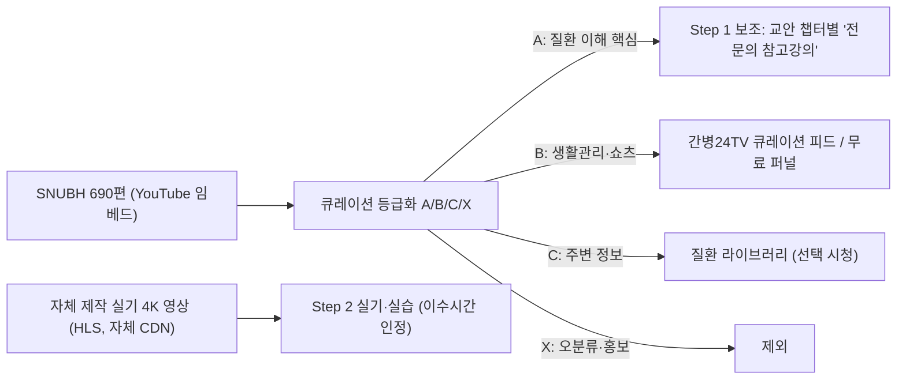
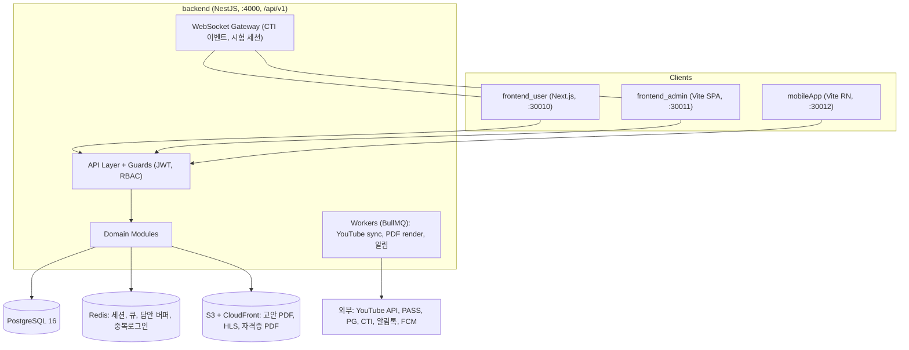
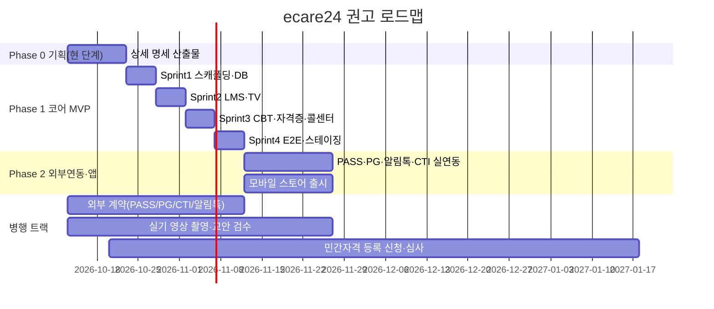

# [구현 계획서] ecare24 환자 질환별 전문간병사 자격과정 통합 플랫폼

- **문서 번호**: ECARE24-IMPL-2026-001 (Rev. 1.0 전면 개정판)
- **작성/개정일자**: 2026. 10. 13
- **플랫폼 명칭**: **한국돌봄종사자양성학원** 통합 플랫폼
- **근거 문서**:
  - 웹·앱 전면 개편 종합 기획: [REVISED_IA_AND_MENU_SPECIFICATION.md](./ux/REVISED_IA_AND_MENU_SPECIFICATION.md) (Rev. 2.0)
  - PRD: [TASK_SPECIFICATION_ECARE24.md](./TASK_SPECIFICATION_ECARE24.md) (ECARE24-SOW-2026-001 Rev. 1.2)
  - 과정 영상 원천: [snubh_16_disease_care_curriculum.md](./snubh_16_disease_care_curriculum.md) (분당서울대병원 @snubh 690편 전수)
  - 임상 용어: [caregiver_terminology_dictionary.md](./caregiver_terminology_dictionary.md) (ECARE24-GLOSSARY-2026-V1)
- **단계 성격**: 기획·상세 아키텍처 수립 (**※ 본 문서는 소스코드를 포함하지 않으며, 스프린트 착수용 명세·WBS·인터페이스만 정의함**)

---

## 0. 요약 (Executive Summary)

| 구분 | 분석 결론 |
| :--- | :--- |
| **개편 정체성** | **한국돌봄종사자양성교육원**: 중장년·실버 수강생 눈높이 최적화, 폰트 확대율 대폭 강화(16→22→28px), 기본 바탕색 일괄 적용(#f8fafc) |
| **단일 수강신청** | 수강신청은 오직 **「돌봄종사자양성자 과정」 단 1개 과정**으로 일원화하여 탐색 혼선 원천 차단 |
| **교육체계 혁신** | **16대 전문 돌봄 자격 트랙 (각 총 8시간)**: 질환별 이론 4h + 실기 4h 단기 집중 완성 체계 |
| **교육원소개 구조화** | ecarecti.co.kr 참조 5대 하위메뉴 체계화 (교육원소개, 대표인사말, 조직안내, 오시는길, 관련사이트) |
| **자격증 신청 통제** | `(교육원 8h 트랙 수료 OR 요양보호사 자격증 보유)` + `심사자 임상간호사의 실습평가서 80점 이상 Pass` 필수 게이트 |
| **돌봄 지침서 탑재** | 분당서울대학교병원 16대 질환군·71개 단위·690편 전수를 최상위 독립 메뉴 **「돌봄 지침서」**로 편성하여 평생 임상 매뉴얼 제공 |
| **범위** | 4대 타겟(`frontend_user`, `frontend_admin`, `backend`, `mobileApp`) + `tests/`, 신규 트랙 DDL(`care_enrollments`, `nurse_field_evaluations`) |
| **일정** | 코어 스프린트 4단계: Sprint 1 (웹 GNB/단일신청) → Sprint 2 (모바일 5대탭) → Sprint 3 (돌봄지침서) → Sprint 4 (간호사평가/자격증) |

---

## 1. 요구사항 추적 매트릭스 (Requirements Traceability)

PRD §9 기능 ID를 기준으로 담당 모듈·화면·테스트를 1:1 매핑한다. (화면 ID는 §8 UI 일련번호 체계)

| 기능 ID | 기능명 | Backend 모듈 | 화면 ID | 우선순위 | E2E 스펙 |
| :--- | :--- | :--- | :--- | :---: | :--- |
| UX-01 | 글자 크기 3단계 | — (클라이언트 Zustand + 서버 사용자설정 동기화) | 전 화면 공통 `SEC00` | P0 | `a11y-scale.spec` |
| UX-02 | 고대비 모드 | — (동일) | 전 화면 공통 | P0 | `a11y-scale.spec` |
| DIS-01 | 질환군 카드 탐색 | `diseases`, `courses` | P01, P02 | P0 | `capture-16-diseases.spec` |
| DIS-02 | 원클릭 이어보기 | `progress` | P01 플로팅바 | P0 | `resume.spec` |
| LMS-01 | 교안 뷰어 + TTS | `courses`, `media-assets` | P03 | P0 | `lms-viewer.spec` |
| LMS-02 | VOD 플레이어(1.5배속·80%·스킵방지) | `progress` | P04 | P0 | `lms-player.spec` |
| LMS-03 | 실습일지 | `practicum` | P05 | P1 | `practicum.spec` |
| EXAM-01 | OMR 모의고사 | `exams` | P06, P07 | P0 | `exam-process.spec` |
| EXAM-02 | 정규 자격시험 | `exams`, `eligibility` | P06(FINAL 모드) | P0 | `exam-process.spec` |
| CERT-01 | 디지털 자격증·지갑 | `certificates` | P08, P09 | P0 | `certificate-render.spec` |
| TV-01 | 숏폼 스와이프 | `media-tv24` | P10 | P1 | `tv24-integration.spec` |
| CS-01 | 3분할 원스크린 | `counseling`, `users`, `progress` | P21 | P0 | `callcenter-cs.spec` |
| CS-02 | CTI 인입 자동 로딩 | `cti-gateway` | P21-SEC01 | P1(Mock P0) | `callcenter-cs.spec` |
| CS-03 | 템플릿·단축키 | `counseling` | P21-SEC03 | P0 | `callcenter-hotkeys.spec` |
| CS-04 | 알림톡 발송 | `notifications` | P21-SEC03 | P1 | — (Mock 검증) |
| ADM-CRS-01 | 질환군 편성/업로드 | `courses`, `media-assets` | P22 | P0 | `admin-curriculum.spec` |
| ADM-EXM-01 | 문제은행·출제 | `exams` | P23 | P0 | `admin-question-bank.spec` |
| ADM-CRT-01 | 직능원 보고 대장 | `certificates` | P24 | P1 | `admin-cert-registry.spec` |
| ADM-CRT-02 | 진위조회·갱신 | `certificates` | P24 | P0 | `admin-cert-registry.spec` |
| ADM-TV-01 | YouTube 동기화 | `media-tv24` (크론) | P25 | P1 | `tv24-integration.spec` |
| **APP-CR-01** | **단일 수강신청 퍼널** (오직 돌봄종사자양성자 과정) | `courses`, `care_enrollments` | P02, P40-TAB-APPLY | P0 | `course-apply.spec` |
| **DUAL-01** | **160h+80h 이원화 교육체계 관리** | `care_enrollments` | P03, P40-TAB-PRACTICE | P0 | `dual-curriculum.spec` |
| **NURSE-EVAL-01** | **간호사 실습평가서 10대 골든룰 채점/Pass 판정** | `nurse_field_evaluations` | P05, P25(Admin) | P0 | `nurse-eval.spec` |
| **GUIDE-01** | **돌봄 지침서 (분당서울대병원 16대 질환 690편)** | `courses`, `media-assets` | P04, P40-TAB-GUIDE | P0 | `care-guidebook.spec` |
| **APP-TAB-01** | **모바일 5대 하단 탭바 네비게이션** | — (React Native / Client) | P40 (전 화면 하단) | P0 | `mobile-tabbar.spec` |

> [!NOTE]
> PRD에 기능 ID가 없지만 본문에 요구된 항목을 **보강 ID**로 추가한다: `AUTH-01`(PASS/간편인증), `PAY-01`(PG 결제·환불), `ELIG-01`(응시자격 자동판정), `RETAKE-01`(재응시권), `RENEW-01`(보수교육 2년 알림), `FUNNEL-01`(무료 교안 1장 다운로드), `CALC-01`(기대수익 계산기), `LIVE-01`(라이브 Q&A), `COMM-01`(현장 고민상담소 게시판), `PROCTOR-01`(시험 이탈 감지·중복로그인 차단·웹캠 옵션).

---

## 2. PRD 갭 및 불일치 분석 (의사결정 필요)

### 2.1 수치·포맷 불일치

| # | 항목 | PRD 내 상충 내용 | 권고안 |
| :---: | :--- | :--- | :--- |
| G1 | 필수 이수시간 | §2.2 "이론40+실기20+실습20=80h" vs §5 `courses.required_hours` 예시 "60시간" | ✅ **확정**: 질환군별 차등. `theory/practical/practicum_hours` 3컬럼 분리, 값은 §12.2 편성표(Phase 0-6)에서 질환군마다 확정 |
| G2 | 자격번호 포맷 | §2.2 `EC24-2026-NEURO-XXXXX` vs §10 `EC24-2026-XXXX` | `EC24-{YYYY}-{질환코드4~6자}-{5자리 시퀀스}` 로 통일 (질환군별 연도 시퀀스) |
| G3 | 진도 기준 | 응시조건 "진도율 80%" — 교안/실기 각각인지 합산인지 불명확 | **Step1·Step2 각각 80% 이상 AND 실습일지 승인 AND 필수시간 충족** |
| G4 | 백엔드 모듈 수 | "8대 모듈"이라 하나 9개 나열(payments 포함) | 9개 + 보강 모듈(progress, practicum, eligibility, notifications, cti-gateway, media-assets) 확정 |
| G5 | Admin 프레임워크/ENV | Vite/Next 혼용, ENV는 `NEXT_PUBLIC_*` | ✅ **확정**: Vite + React 18+ + Ant Design → ENV 접두어 `VITE_*`로 변경 |
| G6 | User 프레임워크 | Next.js / Vite 미확정 | ✅ **확정**: Next.js 14+ App Router + Tailwind CSS (공개 진위조회 `/verify`·질환 소개 SEO/SSR) |
| G7 | 모바일 빌드 방식 | "Expo or RN CLI" + `android/`·`ios/` 폴더 | ✅ **확정**: Expo SDK 51+ + Expo Router (Prebuild/Dev Client, FCM·오프라인 캐싱). `android/ios`는 prebuild 생성물로 취급 |

### 2.2 DDL 누락 테이블 (ERD에는 있으나 DDL 미정의 또는 기능상 필수)

| 테이블 | 용도 | 근거 |
| :--- | :--- | :--- |
| `users` | 회원(수강생/상담원/관리자/지도자 역할) | ERD·FK 참조 대상인데 DDL 없음 |
| `caregiver_profiles` | 경력, 요양보호사 자격 등 | ERD 1:1 |
| `identity_verifications` | PASS CI/DI 암호화 저장 | §11-1 |
| `course_enrollments` | 수강신청·결제 연결·수강기간 | ERD |
| `step_progress` / `video_watch_sessions` | 진도율, 이어보기 위치, 배속·스킵 감사로그 | LMS-02, DIS-02 |
| `practicum_logs` | 실습일지·사진·지도자 서명·승인상태 | LMS-03 |
| `exam_papers` / `exam_paper_questions` | 시험지 구성(랜덤 시드·문항 스냅샷) | ERD |
| `exam_attempts` / `exam_answers` | 응시, 3초 자동저장 답안, 과목별 점수 | EXAM-01/02 |
| `exam_subjects` | 과락(과목별 40점) 판정 단위 | §2.2-3 |
| `retake_vouchers` | 재응시권·유예기간 | §2.2-3 |
| `payments` / `refunds` | PG 결제·환불 | §4.2 payments |
| `tv24_videos` / `external_videos` | 간병24TV·SNUBH 영상 메타·질환 매핑 | §2.3, §3 |
| `notification_logs` | 알림톡/FCM 발송 이력 | CS-04 |
| `audit_logs` | 개인정보 열람·마스킹 해제 감사 | §11-2 |

추가 컬럼 보강:
- `exam_questions`: `subject_id`, `difficulty`, `step_scope(MOCK/FINAL/BOTH)`, `related_material_id`(해설 강의 링크), `review_status`(임상 검수), `terminology_tags[]`.
- `certificates`: `category_id`, `status(VALID/RENEWAL_DUE/EXPIRED/REVOKED)` (`is_valid` 대체), `renewed_from_id`, HMAC 원문 비노출.
- 모든 테이블: `updated_at`, soft delete(`deleted_at`) 정책 통일.

### 2.3 외부 연동 계약 미정 (일정 크리티컬 패스)

| 연동 | 미정 사항 | 리드타임(일반적) | MVP 대응 |
| :--- | :--- | :--- | :--- |
| 본인인증(PASS/NICE/KCB) | 사업자 계약, 테스트 MID | 2~4주 | Mock Provider 인터페이스 |
| PG(결제) | PG사 선정·심사 | 2~4주 | 무료/쿠폰 수강 + Mock |
| CTI | 벤더·프로토콜(WebSocket 이벤트 스펙) | 벤더 의존 | CTI 시뮬레이터(WS) |
| 카카오 알림톡 | 비즈채널·템플릿 심사 | 1~2주 | 로그 저장 Mock |
| 앱스토어 | 개발자 계정·심사 | 1~2주+ | 내부 테스트 트랙 |
| 직능원 민간자격 등록 | 주무부처 등록 심사 | 수개월 | `registry_no`는 등록 전 `PENDING` 상태 운영 |

---

## 3. SNUBH 과정 영상(690편) 분석 및 콘텐츠 매핑 전략

### 3.1 현황 통계

| 질환군 | 편수 | 세부단위 | 비고 |
| :--- | :---: | :---: | :--- |
| 01 신경계 | 59 | 6 | 뇌졸중 22편 — 핵심 코어 콘텐츠 풍부 |
| 02 호흡기 | 25 | 5 | **기관절개관·석션 직접 영상 부재**, 2.5에 오분류 다수 |
| 03 심혈관 | 47 | 6 | 협심증 강의 시리즈 1~7 체계적 |
| 04 근골격·재활 | 50 | 5 | 스트레칭 따라하기 등 실기형 일부 존재 |
| 05 소화기 | 54 | 4 | **경관유동식·PEG 관리 직접 영상 부재**, 5.1 오분류 다수 |
| 06 비뇨·신장 | 73 | 5 | 투석·식단 다수, Foley 관리 직접 영상 소수 |
| 07 내분비 | 34 | 5 | 당뇨발 관련 일부 |
| 08 종양 | 34 | 3 | 항암 부작용 21편 양호 |
| 09 치매·정신 | 26 | 3 | 섬망·BPSD 대처 직접 영상 부족 |
| 10 감염 | 13 | 4 | PPE 5편 |
| 11 중환자 | 13 | 5 | Home-Vent 직접 영상 부재 |
| 12 외상·화상 | 20 | 4 | 욕창 드레싱 일부 |
| 13 노인성 복합 | 184 | 5 | **13.5 "병원 이용 안내" 138편은 커리큘럼 부적합(홍보·안내)** |
| 14 호스피스 | 10 | 2 | |
| 15 소아 희귀 | 24 | 7 | |
| 16 응급기도·연하 | 24 | 2 | **16.1에 "경기도" 키워드 오분류 다수**, 석션 실기 영상 부재 |

### 3.2 품질 이슈 (반드시 정제 후 적재)

1. **키워드 오분류**: 문자열 부분일치로 분류된 흔적이 확인됨.
   - 2.5 폐암 → `폐경 후 질출혈`, `자폐스펙트럼장애`, `녹내장(폐쇄각)` 포함
   - 5.1 간경변 → `간호사의 하루`, `신입간호사 채용`, `치간칫솔`, `허리디스크` 포함
   - 16.1 연하/기도 → `경기도 감염병 세미나`, `경기도 응급의료체계 심포지엄` 포함
   - 3.1 고혈압 → `비흡연 폐암`, 흉부외과 진로 쇼츠 포함
2. **대상 불일치**: 대다수가 **환자·일반인 대상 질환 이해 강좌**이며, 간병 실기(체변, 피딩, 석션, 폴리 관리 등) 시연 영상은 극소수.
3. **제3자 저작물**: 분당서울대병원 채널 소유. 다운로드·재편집·자체 호스팅 불가, **YouTube 공식 임베드만 허용**되는 전제로 설계.

### 3.3 커리큘럼 내 위치 재정의 (권고)



| 등급 | 기준 | 사용처 | 이수시간 인정 |
| :---: | :--- | :--- | :---: |
| **A** | 질환 병태생리·Red Flag·응급대처 직접 관련 (예: 1.3 뇌졸중 전조증상, 3.6 협심증 강의 시리즈) | Step 1 교안 챕터 하단 "전문의 참고강의" | ✅ **확정: Step 1 이론시간 인정** (§12.3 안전장치 적용) |
| **B** | 생활관리·식단·운동, 1분 쇼츠 | 간병24TV 탭, 숏폼 스와이프, 무료 퍼널 | 불인정 |
| **C** | 질환 관련이나 간병 직무 연관 낮음 | 질환 라이브러리 | 불인정 |
| **X** | 오분류, 채용·홍보·병원 안내 | 제외 | — |

> [!NOTE]
> **이수시간 인정 결정 반영**: 사용자 결정에 따라 큐레이션 A등급 전문의 영상은 Step 1 이론 이수시간으로 인정합니다(B/C등급은 불인정 유지). 인정 시간 산정 기준, 상한선(Cap), 가용성 감사 및 안전장치는 [§12.3 확정 사항](#123-확정-사항--snubh-영상-이수시간-인정과-안전장치)을 엄격히 적용합니다.

> [!IMPORTANT]
> PRD Step 2의 "체위 변경, 튜브/카테터 위생, 흡인 보조, 연하 재활 보조 4K 실습 영상"은 SNUBH 자료로 충족되지 않는다. **질환군별 자체 실기 촬영 목록(Shot List)** 을 별도 산출물로 기획해야 하며, 이것이 콘텐츠 측 크리티컬 패스다 (§3.5).

### 3.4 큐레이션 파이프라인 (Admin 기능 `ADM-CRS-02` 신설 제안)

1. **Import**: 마크다운 690행 파서 → `external_videos(youtube_id, title, type[LIVE/VOD/SHORTS], lecturer, source_section)` 적재.
2. **YouTube 메타 보강**: Data API v3로 길이·썸네일·임베드 가능 여부(`status.embeddable`) 확인, 비공개/삭제 영상 자동 비활성.
3. **자동 1차 판정**: 제목 기반 룰(제외 키워드: 채용·브이로그·경기도 심포지엄 등) + 질환 키워드 사전(용어 사전 연계) 점수화.
4. **임상 검수(Human-in-the-loop)**: 간호사 검수자가 Admin에서 등급(A/B/C/X)·질환군·세부단위·연결 교안 챕터 지정.
5. **게시**: A등급은 교안 챕터 매핑, B등급 쇼츠는 TV 피드 핀 고정.

### 3.5 자체 실기 영상 Shot List (질환군별 최소 세트, 용어 사전·10대 골든 룰 기반)

| 질환군 | 필수 실기 영상(예시) | 검증할 골든 룰 |
| :--- | :--- | :--- |
| 01 신경계 | 편마비 환자 탈의·착의, 휠체어 트랜스퍼(보행벨트), 낙상 예방 사이드레일 | 탈건착환, 사이드레일, 마비 팔 당기기 금지 |
| 02 호흡기 | 비강 캐뉴라 관찰, 트라키(T-tube) 주변 위생 관찰 보조, 객담 배출 체위 | 산소 유량 임의조절 금지, SpO2 95% 기준 |
| 05 소화기 | 엘튜브/PEG 피딩 보조 자세, 잔류량 확인 보고, 장루 주머니 비우기 | 반좌위 30~45°, 1/3~1/2 비움 |
| 06 비뇨·신장 | 폴리·유린백 거치·비우기, I&O 기록 | 유린백 방광 하단 거치 |
| 09 치매 | 섬망 vs 치매 구분 대응, BPSD 상황 대처 롤플레이 | 섬망 대응 원칙, 즉시 노티 |
| 12/13 | q2hr 체위변경(앙와위↔측위), 발뒤꿈치 플로팅, 에어매트 점검 | q2hr 체변, 비창백성 발적 노티 |
| 16 응급기도·연하 | 연하곤란 식이보조(토로미), 석션 보조(**의료진 지시 하**) | 토로미 원칙, 석션 1회 15초 이내 |

---

## 4. 목표 시스템 아키텍처



### 4.1 백엔드 모듈 확정안 (Clean Architecture: `domain / application / infrastructure / presentation`)

| 모듈 | 책임 | 비고 |
| :--- | :--- | :--- |
| `auth` | JWT(Access 2h + Refresh), PASS/카카오/네이버, 중복로그인 차단 | Redis 세션 키 1개 강제 |
| `users` | 회원·역할(STUDENT/AGENT/ADMIN/SUPERVISOR/REVIEWER), 프로필 | |
| `diseases` | 16개 질환군 마스터, 세부단위 | 시드 고정 |
| `courses` | 과정·4단계·교안·챕터 | |
| `media-assets` | 업로드, HLS 트랜스코딩 요청, 서명 URL | MediaConvert 연동 |
| `progress` | 진도 이벤트 수집, 80% 판정, 이어보기 | 서버측 재생구간 검증 |
| `practicum` | 실습일지·사진·지도자 서명·승인 | |
| `eligibility` | 응시자격 판정 엔진 | 순수 도메인 서비스 |
| `exams` | 문제은행, 시험지 생성, 자동저장, 채점, 과락 | SERIALIZABLE 제출 |
| `certificates` | 번호 발급, HMAC QR, PDF, 진위조회, 갱신 | 공개 검증 API |
| `media-tv24` | YouTube 동기화(3h), 질환 자동 분류, 핀 고정, 외부영상 큐레이션 | |
| `payments` | PG 결제·환불 | Phase 2 실연동 |
| `counseling` | 티켓·로그·템플릿 | |
| `cti-gateway` | CTI 이벤트 수신 → 상담원 WS 푸시 | Adapter 패턴(벤더 교체) |
| `notifications` | 알림톡·FCM·이메일 | Adapter + 발송 로그 |

---

## 5. 핵심 비즈니스 규칙 명세

### 5.1 응시자격 판정 (`ELIG-01`)
```
eligible(user, course) :=
    enrollment.status == ACTIVE
  ∧ step1.progress ≥ 80%  ∧ step2.progress ≥ 80%
  ∧ practicum.status == APPROVED
  ∧ hours.theory ≥ course.theory_hours ∧ hours.practical ≥ ... ∧ hours.practicum ≥ ...
  ∧ identity_verified == true
  ∧ (no FINAL attempt in progress)
  ∧ (last_fail_at + retake_wait_days ≤ today ∨ valid retake_voucher)
```
- 판정 결과는 **미충족 사유 코드 배열**로 반환 (콜센터 `Alt+2` 템플릿이 사유를 자동 삽입).

### 5.2 진도율 산정 (`LMS-02`)
- 클라이언트는 10초 단위 **재생 구간(heartbeat)** 전송, 서버는 구간 합집합으로 시청 초 계산 → 스킵 구간은 미인정.
- `playbackRate > 1.5` 이벤트 수신 시 해당 구간 미인정 + 플레이어 강제 1.5 복귀.
- 이어보기 위치 = 마지막 heartbeat 위치(-5초).

### 5.3 채점·합격 (`EXAM-02`)
- 과목별 100점 환산 → **어느 과목이든 40점 미만 = 과락 불합격**, 전과목 평균 **60점 이상 = 합격**.
- 제출은 단일 트랜잭션(SERIALIZABLE): `attempt 잠금 → 답안 확정 → 채점 → 결과 기록 → (합격 시) 자격증 발급 요청 이벤트`.
- 정규시험 1회 응시 = 1 attempt, 브라우저 이탈 N회(설정값, 기본 3회) 초과 시 자동 제출 + 감독 로그.

### 5.4 자동 임시저장 (`EXAM-01`)
- 답안 변경 즉시 LocalStorage, 3초 디바운스로 서버 `PATCH /attempts/:id/answers` (멱등, 버전 번호).
- 재접속 시 서버 버전 vs 로컬 버전 비교 후 최신본 복구.

### 5.5 자격증 발급·검증 (`CERT-01`)
- 번호: `EC24-{YYYY}-{CODE}-{00001}` (질환군·연도별 시퀀스, DB 시퀀스 테이블 행잠금).
- QR 페이로드: `https://{verify}/v/{certificate_no}?t={base64url(HMAC-SHA256(secret, certificate_no|issued_at|user_id))[:22]}`.
- 공개 검증 응답은 **마스킹**(성명 `홍*동`, 생년 미노출), 상태 뱃지: `VALID`(녹색) / `RENEWAL_DUE`(황색, 만료 90일 전) / `EXPIRED` / `REVOKED`.
- 유효기간 2년, 보수교육 이수 시 `renewed_from_id` 연결 재발급.

### 5.6 개인정보·보안
- CI/DI: AES-256-GCM 암호화 + 조회용 HMAC 해시 컬럼 분리.
- 상담원 화면 전화번호 중간 4자리 마스킹, 해제 시 사유 입력 + `audit_logs` 기록.
- 녹취 파일: 별도 S3 버킷(SSE-KMS), 보존기간 정책 명시 필요.

---

## 6. API 인터페이스 개요 (OpenAPI 상세는 Phase 0 산출물)

| 영역 | 메서드·경로 | 설명 |
| :--- | :--- | :--- |
| 질환 | `GET /diseases` · `GET /diseases/:code/courses` | 16개 카드, 과정 목록 |
| 과정 | `GET /courses/:id` · `GET /courses/:id/steps` | 4단계 + 내 진도 |
| 진도 | `POST /progress/heartbeat` · `GET /me/resume` | 재생구간, 이어보기 |
| 실습 | `POST /practicum-logs` · `PATCH /practicum-logs/:id/approve` | 제출/승인 |
| 자격 | `GET /courses/:id/eligibility` | 판정 + 사유코드 |
| 시험 | `POST /exams/:paperId/attempts` · `PATCH /attempts/:id/answers` · `POST /attempts/:id/submit` · `POST /attempts/:id/proctor-events` | 응시/저장/제출/이탈 |
| 자격증 | `GET /me/certificates` · `GET /public/verify/:no?t=` · `GET /certificates/:id/pdf` | 지갑/공개검증/PDF |
| TV | `GET /tv24/shorts?disease=` · `POST /funnel/free-material` | 숏폼, 무료교안 |
| 콜센터 | `GET /cs/customers/lookup?phone=` · `GET /cs/customers/:id/overview` · `POST /cs/tickets` · `POST /cs/tickets/:id/logs` · `POST /cs/notify` | 3분할 데이터 |
| CTI | `WS /ws/cti` 이벤트: `CALL_RINGING{caller}`, `CALL_ANSWERED`, `CALL_ENDED{duration, recordingUrl}` | 0.5초 로딩 목표 |
| 관리 | `POST /admin/questions/import`(JSON) · `POST /admin/exam-papers/generate` · `GET /admin/certificates/export.xlsx` · `POST /admin/external-videos/import` | |

---

## 7. 콘텐츠·문제은행 제작 계획

| 산출물 | 수량 기준 | 품질 게이트 |
| :--- | :--- | :--- |
| 이론 교안(PDF + TTS 원문) | 16개 질환군 × 챕터 6~10 | 용어 사전 준수, Red Flag·노티 기준 명시, 간호사 검수 서명 |
| 실기 영상 | 질환군당 5~8편(§3.5) | 골든 룰 체크리스트 통과, 자막 필수(실버 접근성) |
| CBT 문항 | 질환군당 **최소 50문항**(PRD) → 권고 **150문항**(모의 3회분 + 정규 1회분 비중복) | 정답·해설이 골든 룰과 일치, 오기재(유린백 위치, 탈건착환 역순, 석션 시간 초과) = 결함 |
| 용어 툴팁 사전 | 용어 사전 7장 전 항목 | 교안·문항 내 자동 하이라이트 |

> [!WARNING]
> PRD의 "AI 문제은행 대량 합성"은 초안 생성까지만 허용하고, **임상 검수(Care Domain Critic + 간호사) 승인 문항만** `review_status=APPROVED`로 출제 풀에 포함한다.

---

## 8. 화면 목록 및 UI 일련번호 체계

[ui-tagging-inspection.md](../.agents/rules/ui-tagging-inspection.md) 규격(`P##-SEC##-TAG##`, `Alt+I` 토글, 클릭 복사)을 전 화면에 적용한다. 앱 간 충돌 방지를 위해 **번호 대역을 분리**한다.

| 대역 | 대상 |
| :--- | :--- |
| `P00` | 공통 레이아웃(GNB, 글자크기 `[가-/가/가+]`, 고대비 토글, 이어보기 플로팅바) |
| `P01–P19` | `frontend_user` |
| `P20–P39` | `frontend_admin` |
| `P40–P59` | `mobileApp` (testID 동일 값 사용) |

| ID | 화면 | 주요 섹션(예시) |
| :--- | :--- | :--- |
| P01 | 홈 | SEC01 16개 질환 그리드, SEC02 간병24TV 핫클립, SEC03 이어보기 |
| P02 | 질환 과정 상세 | SEC01 4단계 스텝바, SEC02 단계별 CTA, SEC03 전문의 참고강의(SNUBH A등급) |
| P03 | 교안 뷰어 | SEC01 목차, SEC02 본문+용어툴팁, SEC03 TTS 플레이어, SEC04 형광펜/메모 |
| P04 | 실기 VOD | SEC01 플레이어, SEC02 진도바, SEC03 챕터 |
| P05 | 실습일지 | SEC01 작성폼, SEC02 사진첨부, SEC03 지도자 서명 |
| P06 | CBT 응시 | SEC01 문항, SEC02 OMR 카드, SEC03 타이머/미응답 카운트 |
| P07 | 결과·오답노트 | SEC01 과목별 점수/과락, SEC02 오답+해설 강의 링크 |
| P08 | 자격증 센터 | SEC01 카드, SEC02 QR, SEC03 PDF/지갑 |
| P09 | 공개 진위조회 `/verify` | SEC01 번호입력, SEC02 결과 뱃지 |
| P10 | 간병24TV 숏폼 | SEC01 세로 플레이어, SEC02 CTA 칩 |
| P11 | 로그인/본인인증 · P12 마이페이지 · P13 결제 · P14 계산기 · P15 커뮤니티 | |
| P20 | 관리자 대시보드 | |
| P21 | 콜센터 3분할 | SEC00 글로벌바, SEC01 프로필(30%), SEC02 수강/자격(40%), SEC03 티켓/메모(30%) |
| P22 | 과정·콘텐츠 관리 (+외부영상 큐레이션) | |
| P23 | 문제은행·시험지 | |
| P24 | 자격증 대장 | |
| P25 | 간병24TV 관리 | |
| P26 | 실습일지 승인 · P27 회원 · P28 감사로그 | |

- 운영(Production) 빌드에서는 `ui-tagger` 스크립트 미주입(환경변수 `UI_INSPECTOR_ENABLED`), 단 `data-serial-id` 속성은 유지하여 Playwright 셀렉터로 사용.
- 단축키 충돌 점검: 콜센터 `Alt+1~3`, `Alt+S` 와 인스펙터 `Alt+I` 는 비충돌. 브라우저 기본 단축키(`Alt+D` 등) 회피.

---

## 9. WBS 및 일정 (권고: 3 Phase)

> [!IMPORTANT]
> PRD §10 4주 계획을 **Phase 1(코어 MVP)** 로 유지하되, 외부 계약·콘텐츠 제작·직능원 등록은 별도 트랙으로 병행한다.



### Phase 0 — 기획 산출물 (현재 단계, 비개발)

| # | 산출물 | 경로(제안) | 담당 에이전트 |
| :---: | :--- | :--- | :--- |
| 0-1 | 통합 ERD + 전체 DDL(보강 테이블 포함) | `docs/architecture/ddl/` | System Architect |
| 0-2 | OpenAPI 3.1 명세 초안 | `docs/architecture/openapi.yaml` | System Architect |
| 0-3 | `.env.example` 5종 확정본(G5 반영) + `.vscode` 명세 | `docs/architecture/env-spec.md` | System Architect |
| 0-4 | 실버 UX 화면설계 명세(P00–P15, UI ID 포함) | `docs/ux/user-screens.md` | Silver UX Specialist |
| 0-5 | 콜센터 3분할·CTI 이벤트 프로토콜 명세 | `docs/ux/callcenter-spec.md` | Callcenter CS Specialist |
| 0-6 | 16개 질환군 커리큘럼 편성표(시간·챕터) + 실기 Shot List | `docs/curriculum/` | Caregiver Cert Specialist |
| 0-7 | SNUBH 690편 큐레이션 등급표(A/B/C/X) | `docs/curriculum/snubh_curation.csv` | Media TV24 + Cert Specialist |
| 0-8 | 민간자격 관리·운영규정(안), 출제·채점 기준 | `docs/certification/` | Caregiver Cert Specialist |
| 0-9 | E2E 시나리오·캡처 목록 명세 | `docs/qa/e2e-scenarios.md` | Quality & E2E Assurer |

### Phase 1 — 코어 MVP 4주 (PRD §10 기반, 범위 조정)

| Sprint | Day | 작업 | 완료 기준(DoD) |
| :--- | :---: | :--- | :--- |
| **S1 기반** | 1 | docker-compose(PG16, Redis), 마이그레이션, 16개 질환 시드 | `migrate up` 성공, 시드 16행 |
| | 2 | NestJS 모듈 골격 15종, 공통 가드·예외·로깅, config(Joi) | Swagger `/api-docs` 노출 |
| | 3 | user(Next)/admin(Vite)/mobile(Expo) 스캐폴딩, 디자인 토큰, P00 공통 레이아웃, ui-tagger | Alt+I 뱃지 토글·복사 동작 |
| | 4 | `.vscode` launch/tasks, compound 디버그 | 3타겟 동시 디버그 검증 |
| | 5 | OpenAPI → TS 클라이언트·TanStack Query 훅 생성 파이프라인, Mock Provider(PASS/PG/CTI/알림톡) | CI에서 코드 생성 재현 |
| **S2 학습** | 6 | 과정·4단계·교안 메타 API, P01·P02 | 16개 카드·스텝바 렌더 |
| | 7 | 교안 뷰어(워터마크·목차·TTS), VOD(HLS·1.5x·heartbeat) P03·P04 | 스킵 구간 미인정 테스트 통과 |
| | 8 | YouTube 동기화 크론, 외부영상 import·큐레이션 Admin(P22/P25), 숏폼 P10 | 690편 import, 등급 지정 가능 |
| | 9 | 이어보기, 접근성(글자 3단계·고대비) 전 화면 적용, 모바일 홈/상세 | axe 위반 0(AA 자동검사) |
| | 10 | 실습일지 P05 + 승인 P26, 진도 중간점검 | 승인 → 자격판정 반영 |
| **S3 평가·자격·CS** | 11 | 문제은행 import·검수 상태·시험지 랜덤 생성(P23) | 승인 문항만 출제 |
| | 12 | OMR CBT P06(자동저장·미응답·이탈감지·타이머 경고) | 네트워크 차단 후 복구 테스트 |
| | 13 | 채점·과락·재응시권, 결과/오답노트 P07 | 경계값 테스트(39/40/59/60) |
| | 14 | 자격증 번호·HMAC QR·PDF, P08·P09, 대장 엑셀 P24 | 위조 토큰 거부, 중복발급 0 |
| | 15 | 콜센터 P21(CTI 시뮬레이터, 단축키, 템플릿, 마스킹) | 인입→프로필 로딩 ≤0.5s(로컬) |
| **S4 검증** | 16 | Playwright 캡처 슈트(16 질환·CBT·자격증·콜센터) | 3 프로젝트 전부 Green |
| | 17 | Visual Regression(글자 3단계 × 고대비 × 3뷰포트) | 기준 스냅샷 승인 |
| | 18 | 직능원 심사용 캡처 패키지 + 교육과정표 자동 생성 | HTML 리포트 산출 |
| | 19 | 스테이징 배포(Docker), 모바일 내부 테스트 빌드 | 스모크 테스트 통과 |
| | 20 | 보안 점검(OWASP ASVS L2 체크리스트), 부하(CBT 동시 응시) | 치명 취약점 0 |

### Phase 2 — 외부연동·앱 출시 (약 3주)
PASS/NICE 실연동, PG 결제·환불, CTI 벤더 어댑터, 카카오 알림톡 템플릿 승인 후 발송, FCM, 앱스토어 심사, 라이브 Q&A(`LIVE-01`), 커뮤니티(`COMM-01`), 계산기(`CALC-01`).

### Phase 3 — 운영 고도화
민간자격 등록번호 수령 후 `registry_no` 일괄 갱신, 보수교육 과정 개설·갱신 알림 자동화, 웹캠 감독 옵션, 오프라인 교안 캐싱 DRM 강화.

---

## 10. 검증 계획 (Quality Gates)

| 레벨 | 대상 | 도구 | 기준 |
| :--- | :--- | :--- | :--- |
| Unit | eligibility, 채점·과락, 번호·HMAC, 진도 구간 합산 | Jest | 도메인 서비스 커버리지 ≥ 90% |
| Integration | 시험 제출·자격증 발급 트랜잭션, 동시 제출 | Jest + Testcontainers(PG) | 동시 100건 제출 시 중복발급 0 |
| E2E | PRD §4.2 tests/specs 5종 + 보강 5종 | Playwright(Headless), `data-serial-id` 셀렉터 | Green |
| Visual | 글자 3단계·고대비·모바일 | Playwright `toHaveScreenshot` | 승인 기준 대비 diff ≤ 0.1% |
| 접근성 | 전 사용자 화면 | axe-core + 수동(대비 7:1, 터치 48dp) | WCAG AAA 대비·크기 항목 수동 체크리스트 |
| 콘텐츠 | 교안·문항·템플릿 | Care Domain Critic 체크리스트 | 골든 룰 위반 0 |
| 보안 | 인증·개인정보·QR 위조 | OWASP ZAP, 수동 | High 이상 0 |

---

## 11. 리스크 및 법·규정 검토 항목

| # | 리스크 | 영향 | 대응 |
| :---: | :--- | :--- | :--- |
| R1 | 민간자격 표기: PRD의 `[정상 인증 / 보건복지부-직능원 등록]` 문구는 국가·공인자격 오인 소지 | 규정 위반·신뢰도 | 자격기본법상 민간자격 표시 의무 문구(등록번호, 국가자격 아님 등)로 대체 — **법무 확인 필요** |
| R2 | 의료행위 경계: 석션·튜브 관리 등은 의료인 업무와 경계가 모호 | 법적·안전 | 교안·영상을 "의료진 지시 하 보조/관찰·보고" 중심으로 서술, 법무·간호 자문 |
| R3 | 제3자 YouTube 콘텐츠: 플레이어 기능 제한(배속 제한 등)·유료 상품 내 사용 | 정책 위반 | 공식 임베드만 사용. **SNUBH 이수 인정 확정에 따라 병원 측 서면 이용 협의를 Phase 1 착수 전 필수 선행(블로커)로 격상**. 협의 불발 시 인정 대상을 자체 제작 영상으로 대체하는 폴백 유지 |
| R4 | 웹 DRM 한계: 캡처 방지는 웹에서 완전 차단 불가 | 콘텐츠 유출 | 동적 워터마크(이름·ID·시각) + 서명 URL 만료로 추적성 확보 |
| R5 | 4주 일정 | 품질 저하 | §9 Phase 분리, Mock 우선 |
| R6 | 실버 사용자 본인인증 이탈 | 전환율 | 간편인증 우선 노출, 콜센터 보조 가이드 |
| R7 | 콘텐츠 제작 지연(실기 촬영) | Step 2 공백 | 질환군 우선순위(01·05·06·13·16 선행) 단계 오픈 |

---

## 12. 의사결정 요청 사항 (Open Questions)

### 12.1 확정 사항 — 기술 스택 및 모노레포 (Rev 0.2)

| 타겟 | 확정 스택 |
| :--- | :--- |
| `frontend_user/` | Next.js 14+ (App Router), Tailwind CSS, TanStack Query, Zustand |
| `frontend_admin/` | Vite + React 18+, Ant Design |
| `mobileApp/` | React Native + Expo SDK 51+, Expo Router |
| `packages/types` | 공통 TS 타입(OpenAPI 생성 DTO, enum: `StepType`, `CertStatus`, 사유코드 등) |
| `packages/utils` | 공통 순수 로직(자격번호 포맷, 진도 구간 합산, 과락/합격 계산, 마스킹, 이수시간 환산) |
| 빌드 오케스트레이션 | **Turborepo** (+ 패키지 매니저 workspaces) |

```text
ecare24/
├── turbo.json · package.json(workspaces) · .env.example
├── frontend_user/  frontend_admin/  mobileApp/  backend/  tests/
├── packages/
│   ├── types/      # 앱 간 단일 타입 소스 (backend OpenAPI → 생성)
│   └── utils/      # 클라이언트·서버 공용 순수 함수 (UI 의존성 금지)
└── docs/
```

- **파이프라인**: `types` → `utils` → 각 앱 순서로 `build/lint/test` 캐시 (`turbo run --filter`).
- **경계 규칙**: `packages/*`는 React/Node 전용 API 미사용(웹·RN·Nest 모두 import 가능). 채점·자격판정 **정답 로직의 단일 소스는 backend**이며, `utils` 사본은 UI 사전 안내용(서버 재검증 필수).
- **ENV**: Admin=`VITE_*`, User=`NEXT_PUBLIC_*`, Mobile=`EXPO_PUBLIC_*`. 비밀값은 앱 번들에 포함 금지(YouTube API 키는 backend 전용 — PRD의 `NEXT_PUBLIC_YOUTUBE_API_KEY` 제거).
- **영향**: §9 Sprint1 Day 3·5 스캐폴딩에 Turborepo 초기화 및 `packages/*` 생성이 포함됨. PRD §4.2 폴더 구조에 `packages/` 추가(변경 승인 이력으로 기록).

### 12.2 확정 사항 — 질환군별 차등 이수시간

- 모든 질환군은 `theory_hours / practical_hours / practicum_hours` 개별 값을 가진다 (PRD 예시 40/20/20은 **참고 기준값**일 뿐).
- 산정 근거 가이드(Phase 0-6 편성표에서 질환군별 확정, 간호 자문 필수): 의료 의존도·시술 복잡도가 높은 군(예: 05 소화기=피딩/PEG/장루, 06 비뇨=폴리, 11 중환자, 16 응급기도)은 **실기·실습 비중 상향**, 인지·정신·호스피스 군은 **이론·커뮤니케이션 비중 상향**.
- 응시자격(§5.1)은 `course.*_hours` 질환군별 값을 참조. `utils`의 환산 함수와 backend 판정이 동일 입력 테스트 벡터를 공유.
- 질환군별 값 변경 이력은 `course_versions`(또는 `courses.version`)로 관리 — 수강 시작 시점 버전 고정(소급 적용 금지).

### 12.3 확정 사항 — SNUBH 영상 이수시간 인정과 안전장치

이수 인정이 확정됨에 따라, 인정이 **감사 가능**하도록 아래 규칙을 적용한다. (아래 수치는 제안값이며 Phase 0-8 운영규정에서 최종 확정)

1. **인정 범위**: 큐레이션 **A등급**만, **Step 1 이론시간**에만 가산. 실기·실습시간은 자체 제작 영상·실습일지로만 충족.
2. **상한(Cap)**: 질환군별 `snubh_credit_cap_hours` 컬럼 신설. 제안: 해당 군 `theory_hours`의 **50% 이내** (교안 학습이 외부 영상으로 대체되지 않도록).
3. **시간 산정**: 영상 길이가 아닌 **서버가 검증한 실시청 시간**. YouTube IFrame Player API의 `onStateChange`·`getCurrentTime`·`getPlaybackRate` 기반 heartbeat 수집(`video_watch_sessions`에 `source=YOUTUBE_EMBED` 구분).
4. **통제 한계 명시**: 임베드는 자체 호스팅 대비 스킵·배속·탭 이탈 통제력이 낮음 → ① 재생속도 1.0 초과 구간 미인정 ② 탭 비활성(visibilitychange) 구간 미인정 ③ 구간 합집합 80% 이상일 때만 해당 영상 완료 인정 ④ 영상별 확인 퀴즈(1~3문항) 통과 시 인정(권고).
5. **영상 완료 단위 인정**: 부분 시청은 가산하지 않음(영상 단위 all-or-nothing, 길이는 YouTube API `contentDetails.duration`).
6. **가용성 위험**: 영상 비공개·삭제·임베드 차단 시 이미 인정된 시간은 유지하고(`credited_snapshot` 보존), 신규 수강자에겐 대체 영상 매핑. 일 1회 가용성 점검 잡 추가(`media-tv24`).
7. **DDL 영향**: `external_videos(credit_eligible, grade, duration_sec, last_checked_at)`, `step_progress.credited_seconds_by_source`, `courses.snubh_credit_cap_hours`.
8. **직능원 등록 서류**: 이수시간 구성(자체 vs 외부 영상 비율)과 외부 콘텐츠 이용 권한 증빙을 교육과정표에 명기.

> [!WARNING]
> 제3자(병원) 영상을 유료 과정의 공식 이수시간으로 활용하는 것은 병원 측 이용 허락과 유튜브 약관 양쪽 확인이 필요합니다(R3). 협의 결과에 따라 상한·인정 범위가 조정될 수 있습니다.

### 12.4 확정 사항 — MVP 범위 (화면 16개 군 전체 / 실제 콘텐츠 5개 군)

- **전 16개 군**: 질환 마스터, 카드·스텝바 화면, 과정 상세, 교안 뷰어 골격, 문제은행 구조, 자격증 템플릿을 모두 개방. 콘텐츠 미탑재 군은 상태 `COMING_SOON`(수강신청 불가, 알림 신청 CTA).
- **콘텐츠 탑재 5개 군(잠정안, 확정 필요)**: 아래 선정 기준 — ① 간병 현장 수요(피딩·폴리·체변·섬망 등 10대 골든 룰 커버) ② SNUBH A등급 확보량 ③ 자체 실기 촬영 용이성.

| 순위 | 질환군 | 선정 사유 | 우려 |
| :---: | :--- | :--- | :--- |
| 1 | **01 신경계** | 뇌졸중 편마비(탈건착환·트랜스퍼·낙상), SNUBH 59편 풍부 | — |
| 2 | **05 소화기·간담도** | 피딩·엘튜브·PEG·장루 실기 비중 최고 | SNUBH 오분류 최다 → 큐레이션 선행, A등급 부족 시 이론 상한 활용도 낮음 |
| 3 | **06 비뇨·신장** | 폴리·유린백·투석, SNUBH 73편 | Foley 직접 영상 소수 |
| 4 | **09 인지·정신·치매** | 섬망·BPSD, 간병 수요 최상위 | SNUBH 26편 중 간병 직결 소수 |
| 5 | **13 노인성 복합만성** | 체변 q2hr·욕창·와상 토탈케어 | 184편 중 138편 제외 대상 → 실질 A등급 소량 |

- **대안**: 데이터가 풍부한 03 심혈관(47편, 협심증 시리즈)·08 종양(34편)을 13 또는 05 대신 넣는 안 → 콘텐츠 품질 우선이면 대안 채택. **Phase 0-7 큐레이션 결과(군별 A등급 편수)로 최종 확정**.
- **오픈 순서 영향**: 16(응급기도·연하)·02(호흡기)는 석션 실기 의료 경계(R2)로 후순위.

### 12.5 남은 의사결정 사항

1. **MVP 5개 군 최종 확정** (§12.4 잠정안 승인 또는 교체)
2. **SNUBH 이용 협의 담당·일정** 및 **인정 상한 비율(제안 50%)** 승인
3. **정규시험 형식**: 실기 시뮬레이션 문항(CASE_STUDY) 비중, 과목 구성(예: 질환이해/간병실무/응급·안전)
4. **CTI 벤더·알림톡 대행사**: 선정 일정
5. **Phase 0 산출물 착수 순서**: 0-1(DDL)·0-6(질환군별 이수시간 편성표) 우선 권고

---

## 13. 변경 이력

| Rev | 일자 | 내용 |
| :--- | :--- | :--- |
| 0.1 | 2026-10-12 | PRD Rev 1.2 및 SNUBH 690편 분석 기반 초안 작성 |
| 0.2 | 2026-10-12 | 사용자 결정 반영: Next/Vite+AntD/Expo + Turborepo(packages/types·utils), 질환군별 이수시간, SNUBH A등급 이수 인정(안전장치), MVP 5개 군 콘텐츠(잠정) |
