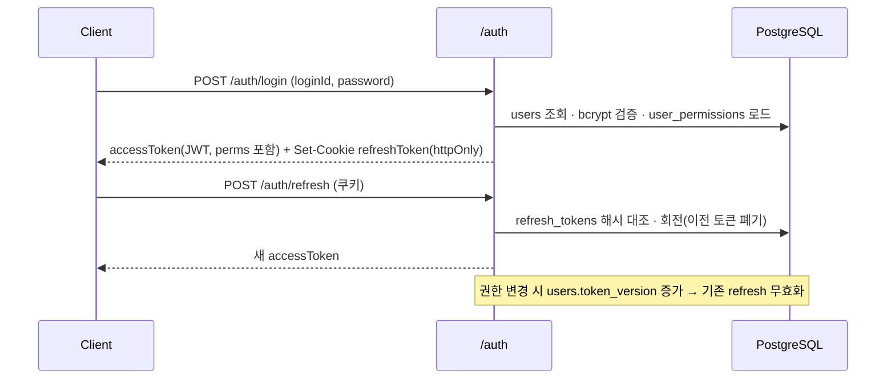
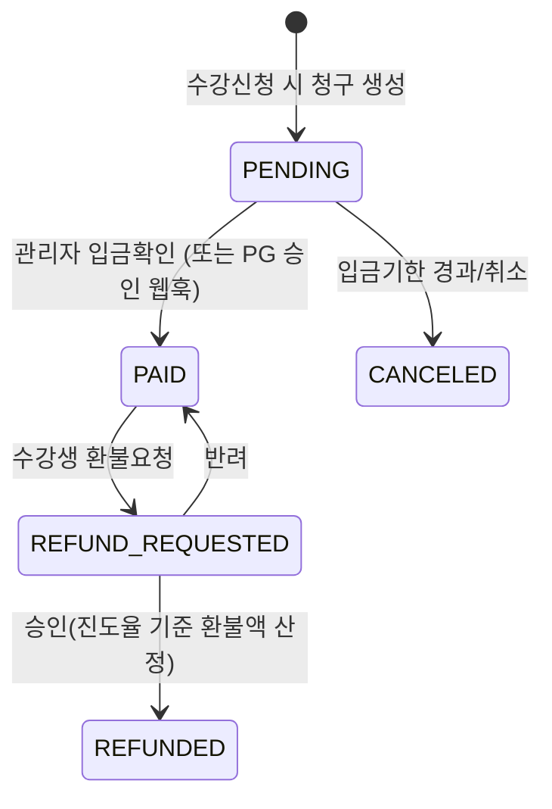

# 🧭 메뉴 보완 및 Backend 구성 계획서 (Rev 1.0)

> **문서 번호**: `ECARE24-ARCH-2026-002`  ·  **작성일**: 2026-10-19
> **대상**: `frontend_user`(30010) · `frontend_admin`(30011) · `mobileApp`(30012) · **`backend`(30014, 신규)**
> **선행 문서**: [REVISED_IA_AND_MENU_SPECIFICATION.md](file:///apps/ex_project_ecare24_elearning/docs/ux/REVISED_IA_AND_MENU_SPECIFICATION.md), [01_master_schema.sql](file:///apps/ex_project_ecare24_elearning/docs/architecture/ddl/01_master_schema.sql)
> **DDL 확장안**: [02_auth_payment_admin_schema.sql](file:///apps/ex_project_ecare24_elearning/docs/architecture/ddl/02_auth_payment_admin_schema.sql)
>
> ※ 본 문서는 **기획·아키텍처 단계 산출물**이며, 소스코드 구현은 승인 후 스프린트에서 진행합니다.

---

## 0. 의사결정 요약

| 항목 | 확정 사항 |
| :--- | :--- |
| API 방식 | **RESTful** (`/api/v1/...`, 리소스 명사형 URI, HTTP 메서드 의미 준수, JSON) |
| 기술 스택 | **NestJS 10 + TypeORM 0.3 + PostgreSQL 16** (마이그레이션·시드는 TypeORM CLI 기반) |
| 인증 | 이메일(또는 휴대폰)+비밀번호 → **JWT Access(15분) + Refresh(14일, httpOnly 쿠키, DB 회전 저장)** |
| 권한 | **역할(Role) 없음.** `permissions`(권한 마스터) + `user_permissions`(사용자별 권한 리스트, 행 단위) |
| 납부 | 1차: **무통장입금 + 관리자 수동 입금확인**, PG는 **토스페이먼츠 기준 인터페이스만 설계** |
| 목업 정리 | `packages/utils/src/mockData.ts` **전면 삭제** → 기준 데이터는 DB 시드로 이관, 화면은 API 호출로 교체 |
| 환경 변수 | 비밀값·접속정보·외부키는 **`.env`** 로만 관리, 커밋 대상은 `.env.example` 뿐 |
| 교육 영상 | HeyGen 예제 2편을 `course_videos`(source=`HEYGEN`)로 시드 등록 |

---

## 1. 메뉴 보완 (IA Rev 2.4 제안)

### 1-1. 수강생 웹 (`frontend_user`)

```text
[P00-SEC00] 실버 유틸리티 탑바
 ├── 글자크기 [가-/가/가+] · 고대비 토글
 ├── 공지사항 (/notices)                        ← 신규 (P16)
 └── 로그인 | 회원가입   또는   ○○○님 · 로그아웃   ← 신규 (로그인 상태별 전환)

[P00-SEC01] GNB (드롭다운 없음 · 실버 원칙 유지)
 ├── [M01] 교육원소개   /about
 ├── [M02] 교육체계     /curriculum   (수강신청 CTA 포함)
 ├── [M03] 돌봄 지침서  /guidebook    (현행 /tv24 경로 정리)
 ├── [M04] 자격증       /verify
 └── [M05] 마이페이지   /mypage       ← 신규 (기존 '박순자 돌봄교육생님' 하드코딩 칩 대체)

[전역] 로그인 시 공지 팝업 레이어 (관리자 '팝업 공지' 연동, "오늘 하루 보지 않기")
```

#### 마이페이지 서브 메뉴 (좌측 세로 탭 · 모바일은 상단 가로 탭)

| 코드 | 경로 | 서브 메뉴 | 주요 내용 |
| :--- | :--- | :--- | :--- |
| P10 | `/mypage` | **나의 현황 요약** | 진도율 링, 이어보기 버튼, 미납 알림, 자격증 단계 미니 타임라인 |
| P11 | `/mypage/courses` | **수강 진행 상황** | 과정/트랙별 진도율, 차시 목록·이어보기, 실습일지 제출 상태, 모의고사 결과 |
| P12 | `/mypage/payments` | **납부 상황** | 청구 내역, 입금 계좌·입금기한, 상태(입금대기/확인완료/환불요청/환불완료), 영수증 출력 |
| P13 | `/mypage/certificates` | **자격증 발급 상황** | 신청 단계 타임라인(신청→서류확인→간호사 평가→심사→발급), 평가서 열람, 자격증 PDF·QR |
| P14 | `/mypage/inquiries` | **상담·문의 내역** | 1:1 문의 작성, 콜센터 상담 처리 결과 열람 |
| P15 | `/mypage/profile` | **회원정보 관리** | 연락처·비밀번호 변경, 요양보호사 자격번호 등록, 접근성 설정 저장 |

#### 인증 화면
| 코드 | 경로 | 내용 |
| :--- | :--- | :--- |
| P09 | `/login`, `/signup`, `/password/reset` | 큰 입력칸(56px), 비밀번호 보기 토글, 전화상담 바로걸기 병기 |

### 1-2. 모바일 앱 (`mobileApp`) 하단 5탭 재구성

| 현행 | 변경 | 비고 |
| :--- | :--- | :--- |
| 홈 · 교육원소개 · 교육체계 · 돌봄지침서 · 자격증 | **홈 · 교육체계 · 돌봄지침서 · 자격증 · MY** | 교육원소개는 홈 배너/헤더 메뉴로 이동 |

- `P40-TAB-MY` 신규 → `P48` MY 화면(웹 P10~P15와 동일 서브 구성, 세로 리스트형)
- `P49` 모바일 로그인 (자동로그인 체크 기본 ON, Refresh 토큰 SecureStorage 보관)

### 1-3. 관리자·콜센터 (`frontend_admin`) — 상단 3탭 → **좌측 LNB**

| LNB | 코드 | 화면 | 필요 권한(대표) |
| :--- | :--- | :--- | :--- |
| 대시보드 | P50 | KPI 카드, 일별 가입/입금/수료 차트, 처리대기 큐(입금확인·실습평가·자격심사·미처리 상담) | `DASHBOARD_VIEW` |
| 수강생 관리 | P55 | 목록(검색·필터·엑셀), 상세 탭(기본정보/수강/납부/자격/상담/접속이력), 수강 수동등록·연장 | `STUDENT_READ`, `STUDENT_WRITE` |
| 과정 관리 | P51 | 과정·트랙 CRUD, 차시/영상(HeyGen·YouTube·자체HLS) 등록, 게시 on/off | `COURSE_READ`, `COURSE_WRITE` |
| 문제은행·CBT | P54 | 문항 CRUD, 임상 검수 승인, 응시 결과 | `EXAM_MANAGE` |
| 납부 관리 | P56 | 입금대기 목록, 입금확인 처리, 환불 승인/반려 | `PAYMENT_READ`, `PAYMENT_CONFIRM`, `PAYMENT_REFUND` |
| 실습·간호사 평가 | P57 | 실습일지 승인, 10대 항목 평가서 작성 (`P25-NURSE-EVAL` 계승) | `PRACTICUM_REVIEW`, `NURSE_EVAL_WRITE` |
| 자격증 관리 | P53 | 신청 심사, 발급/재발급/취소, 발급 대장 | `CERT_REVIEW`, `CERT_ISSUE`, `CERT_REVOKE` |
| 콜센터 CS | P52 | 기존 3분할 원스크린 유지 + 실데이터 연동, 단축키(Alt+1~3, Alt+S) | `COUNSEL_HANDLE` |
| 공지·팝업 | P58 | 공지 게시판 CRUD, **팝업 공지**(노출기간·대상·위치·우선순위·이미지·링크) | `NOTICE_MANAGE`, `POPUP_MANAGE` |
| 시스템 | P59 | 관리자 계정, **사용자×권한 체크 매트릭스**, 감사로그, 공통코드 | `PERMISSION_MANAGE`, `AUDIT_READ` |

- `P60` 관리자 로그인 화면 신설 (현행 무인증 진입 제거)
- LNB 항목은 **보유 권한에 따라 자동 노출/숨김**, 서버는 동일 권한으로 재검증

> UI 인스펙트: 신규 코드(P09~P16, P48~P49, P55~P60)는 `SCREEN_META_MAP`·`ROUTE_PAGE_NAME_MAP`에 등록 필요 (Alt+I 4대 정보 복사 규격 동일 적용).

---

## 2. Backend 아키텍처

### 2-1. 디렉토리 구조

```text
backend/
├── .env.example
├── package.json
├── src/
│   ├── main.ts                     # 글로벌 prefix /api/v1, ValidationPipe, Helmet, CORS
│   ├── app.module.ts
│   ├── config/                     # @nestjs/config + Joi 스키마 검증(.env 누락 시 기동 실패)
│   ├── common/
│   │   ├── decorators/             # @RequirePermissions(), @CurrentUser(), @Public()
│   │   ├── guards/                 # JwtAuthGuard, PermissionsGuard
│   │   ├── interceptors/           # 응답 래핑, 감사로그(AuditInterceptor)
│   │   ├── filters/                # 표준 에러 응답 변환
│   │   └── crypto/                 # AES-256-GCM(PII), HMAC(QR·CI 조회용)
│   ├── database/
│   │   ├── data-source.ts          # TypeORM CLI용 DataSource
│   │   ├── migrations/             # 01·02 DDL을 마이그레이션으로 이관
│   │   └── seeds/
│   │       ├── 01-permissions.seed.ts
│   │       ├── 02-disease-categories.seed.ts
│   │       ├── 03-golden-rules-terminology.seed.ts
│   │       ├── 04-courses-videos.seed.ts   # 단일 과정 + 16트랙 + HeyGen 2편
│   │       ├── 05-exam-questions.seed.ts
│   │       ├── 06-super-admin.seed.ts      # .env의 초기 관리자 계정
│   │       └── demo/                       # 선택: 데모 수강생 (운영 금지)
│   └── modules/
│       ├── auth/  users/  permissions/
│       ├── diseases/  courses/  videos/  enrollments/  progress/
│       ├── practicum/  nurse-evaluations/  exams/  certificates/
│       ├── payments/  (PaymentGateway 인터페이스: ManualBankTransfer / TossPayments)
│       ├── notices/  popups/  counseling/  dashboard/  audit/  files/
└── test/                           # e2e (supertest)
```

각 모듈은 `controller → service → repository(TypeORM)` + `dto/`(class-validator) + `entities/` 구성.

### 2-2. REST 공통 규약

| 항목 | 규약 |
| :--- | :--- |
| URI | `/api/v1/{복수명사}/{id}/{하위리소스}`, kebab-case |
| 메서드 | GET 조회 · POST 생성 · PATCH 부분수정 · DELETE 삭제(소프트) · 상태전이는 하위 리소스 POST (예: `POST /payments/{id}/confirmations`) |
| 목록 | `?page=1&size=20&sort=createdAt,desc&q=검색어` → `{ items, page, size, total }` |
| 에러 | `{ code: "PAYMENT_ALREADY_CONFIRMED", message, details? }` + 적절한 HTTP 상태 |
| 범위 | 수강생용 `/me/...`, 관리자용 `/admin/...` 경로 분리 |
| 문서 | `@nestjs/swagger` → `/api/docs` (운영은 `SWAGGER_ENABLED=false`) |

---

## 3. 로그인 및 권한 설계

### 3-1. 인증 흐름



- 비밀번호: bcrypt(cost 12), 5회 실패 시 10분 잠금(`login_histories` 기록)
- 수강생(`user_type=STUDENT`)은 권한 없이도 **본인 리소스(`/me/*`)** 접근 가능
- 관리자 포털 진입은 `ADMIN_PORTAL_ACCESS` 보유자만 허용

### 3-2. 권한 모델 (역할 없음 · 사용자별 리스트)

```text
permissions (code PK, group_name, name_ko, description, display_order)
user_permissions (user_id, permission_code, granted_by, granted_at)  PK(user_id, permission_code)
```

- 컨트롤러: `@RequirePermissions('PAYMENT_CONFIRM')` → `PermissionsGuard`가 JWT의 `perms` 배열로 판정
- 관리 화면(P59): 행=관리자, 열=권한 코드의 **체크 매트릭스**로 일괄 부여/회수, 변경 내역은 `audit_logs`
- 편의 기능: "권한 묶음 복사"(다른 사용자의 권한 목록을 그대로 복제) — 역할 테이블 없이 운영 편의 제공

### 3-3. 권한 코드 마스터 (시드 대상)

| 그룹 | 코드 |
| :--- | :--- |
| 공통 | `ADMIN_PORTAL_ACCESS`, `DASHBOARD_VIEW` |
| 수강생 | `STUDENT_READ`, `STUDENT_WRITE`, `STUDENT_PII_UNMASK`, `ENROLLMENT_MANAGE` |
| 과정 | `COURSE_READ`, `COURSE_WRITE`, `VIDEO_MANAGE`, `EXAM_MANAGE` |
| 납부 | `PAYMENT_READ`, `PAYMENT_CONFIRM`, `PAYMENT_REFUND` |
| 실습·자격 | `PRACTICUM_REVIEW`, `NURSE_EVAL_WRITE`, `CERT_REVIEW`, `CERT_ISSUE`, `CERT_REVOKE` |
| 콜센터 | `COUNSEL_HANDLE`, `COUNSEL_READ_ALL` |
| 공지 | `NOTICE_MANAGE`, `POPUP_MANAGE` |
| 시스템 | `PERMISSION_MANAGE`, `AUDIT_READ`, `SYSTEM_SETTING` |

---

## 4. DB 스키마 확장 요약

상세 DDL: [02_auth_payment_admin_schema.sql](file:///apps/ex_project_ecare24_elearning/docs/architecture/ddl/02_auth_payment_admin_schema.sql)

| 구분 | 테이블 | 변경 |
| :--- | :--- | :--- |
| 변경 | `users` | `role` 컬럼 제거 → `user_type`(STUDENT/STAFF), `login_id`, `token_version`, `status`, `last_login_at` 추가 |
| 변경 | `courses` | `course_type`(MAIN/TRACK), `is_published`, `thumbnail_url` 추가 |
| 변경 | `video_source_enum` | `HEYGEN` 값 추가 |
| 신규 | `permissions`, `user_permissions` | 권한 마스터·사용자별 권한 리스트 |
| 신규 | `refresh_tokens`, `login_histories` | 토큰 회전·접속 이력 |
| 신규 | `course_videos` | 차시 영상(HeyGen/YouTube/HLS), 순서·재생시간·미리보기 여부 |
| 신규 | `payments`, `refunds` | 청구·입금확인·환불 (PG 필드 예약) |
| 신규 | `cert_applications` | 자격증 신청 단계 추적 (마이페이지 타임라인 근거) |
| 신규 | `notices`, `popup_notices` | 공지 게시판·팝업 공지 |
| 신규 | `inquiries` | 수강생 1:1 문의 |
| 신규 | `golden_rules`, `caregiver_terms` | 하드코딩된 10대 골든 룰·용어사전을 DB 기준 데이터로 이관 |
| 신규 | `system_settings` | 입금계좌·고객센터 번호 등 운영 설정 (비밀 아님) |

---

## 5. RESTful API 명세 (1차)

### 5-1. 인증·공개
| Method | URI | 설명 | 권한 |
| :--- | :--- | :--- | :--- |
| POST | `/auth/signup` | 회원가입 | Public |
| POST | `/auth/login` · `/auth/refresh` · `/auth/logout` | 로그인·재발급·로그아웃 | Public/인증 |
| POST | `/auth/password-resets` | 비밀번호 재설정 요청 | Public |
| GET | `/disease-categories` | 16대 질환군 | Public |
| GET | `/courses` · `/courses/{id}` · `/courses/{id}/videos` | 과정·차시 목록(미리보기 영상만 비로그인 허용) | Public |
| GET | `/golden-rules` · `/caregiver-terms?q=` | 골든 룰·용어사전 | Public |
| GET | `/notices` · `/notices/{id}` · `/popups/active` | 공지·활성 팝업 | Public |
| GET | `/certificates/verify?token=` | QR 진위 검증 | Public |

### 5-2. 수강생 (`/me`)
| Method | URI | 설명 |
| :--- | :--- | :--- |
| GET/PATCH | `/me` | 내 정보·접근성 설정 |
| GET | `/me/summary` | 마이페이지 요약(P10) |
| GET/POST | `/me/enrollments` | 수강 목록·수강신청(→ 청구서 자동 생성) |
| GET | `/me/enrollments/{id}/progress` | 차시별 진도(P11) |
| PUT | `/me/videos/{videoId}/progress` | 시청 위치·구간 하트비트 저장 |
| GET/POST | `/me/practicum-logs` | 실습일지 |
| GET/POST | `/me/payments` · `POST /me/payments/{id}/refund-requests` | 납부 상황(P12)·환불 요청 |
| GET/POST | `/me/cert-applications` | 자격증 신청·단계 조회(P13) |
| GET | `/me/certificates` · `/me/certificates/{id}/pdf` | 발급 자격증 |
| GET/POST | `/me/inquiries` | 1:1 문의(P14) |

### 5-3. 관리자 (`/admin`)
| Method | URI | 권한 |
| :--- | :--- | :--- |
| GET | `/admin/dashboard/kpis` · `/admin/dashboard/queues` | `DASHBOARD_VIEW` |
| GET/POST/PATCH | `/admin/students` · `/admin/students/{id}` | `STUDENT_READ`/`STUDENT_WRITE` |
| POST | `/admin/students/{id}/pii-unmask` (사유 필수, 감사로그) | `STUDENT_PII_UNMASK` |
| POST/PATCH | `/admin/enrollments` · `/admin/enrollments/{id}` (수동등록·기간연장) | `ENROLLMENT_MANAGE` |
| CRUD | `/admin/courses` · `/admin/courses/{id}/videos` | `COURSE_WRITE`/`VIDEO_MANAGE` |
| CRUD | `/admin/exam-questions` | `EXAM_MANAGE` |
| GET | `/admin/payments?status=PENDING` | `PAYMENT_READ` |
| POST | `/admin/payments/{id}/confirmations` | `PAYMENT_CONFIRM` |
| POST | `/admin/refunds/{id}/approvals` · `/rejections` | `PAYMENT_REFUND` |
| PATCH | `/admin/practicum-logs/{id}` (승인/반려) | `PRACTICUM_REVIEW` |
| POST | `/admin/nurse-evaluations` | `NURSE_EVAL_WRITE` |
| GET/PATCH | `/admin/cert-applications/{id}` | `CERT_REVIEW` |
| POST | `/admin/certificates` · `/admin/certificates/{id}/revocations` | `CERT_ISSUE`/`CERT_REVOKE` |
| CRUD | `/admin/counseling-tickets` · `GET /admin/cti/lookup?phone=` | `COUNSEL_HANDLE` |
| CRUD | `/admin/notices` · `/admin/popups` | `NOTICE_MANAGE`/`POPUP_MANAGE` |
| GET/PUT | `/admin/users/{id}/permissions` · `GET /admin/permissions` | `PERMISSION_MANAGE` |
| GET | `/admin/audit-logs` | `AUDIT_READ` |

### 5-4. 납부 상태 전이

- `PAID` 전이 시 해당 `course_enrollments.status` → `ACTIVE` 자동 활성화
- PG 확장: `PaymentGateway` 인터페이스(`requestPayment`, `confirm`, `cancel`, `handleWebhook`) — 1차 `ManualBankTransferGateway`만 구현, `TossPaymentsGateway`는 2차

---

## 6. 하드코딩 목업 데이터 정리 계획

### 6-1. 현황 인벤토리 ([mockData.ts](file:///apps/ex_project_ecare24_elearning/packages/utils/src/mockData.ts), 906줄)

| 목업 상수 | 성격 | 처리 방침 | 대체 API |
| :--- | :--- | :--- | :--- |
| `MOCK_DISEASES` | 기준 데이터 | **시드 이관** (`02-disease-categories`) | `GET /disease-categories` |
| `MOCK_GOLDEN_RULES` | 기준 데이터 | **시드 이관** (`golden_rules`) | `GET /golden-rules` |
| `MOCK_TERMINOLOGY` | 기준 데이터 | **시드 이관** (`caregiver_terms`) | `GET /caregiver-terms` |
| `MOCK_MVP_COURSES` | 운영 데이터 | 단일과정+16트랙 구조로 재작성 후 시드 | `GET /courses` |
| `MOCK_EXAM_QUESTIONS` | 운영 데이터 | 임상 검수 표시 후 시드 | `GET /admin/exam-questions` |
| `MOCK_CURATED_VIDEOS` | 운영 데이터 | HeyGen 2편 기준 `course_videos` 재구성 | `GET /courses/{id}/videos` |
| `MOCK_CUSTOMER_PROFILES` | 가짜 개인정보 | **삭제** (필요 시 `seeds/demo`에 명백한 가명으로만) | `GET /admin/students` |
| `MOCK_COUNSELING_TICKETS` | 가짜 업무 데이터 | **삭제** | `GET /admin/counseling-tickets` |

### 6-2. 화면 내 인라인 하드코딩 정리 대상
| 위치 | 하드코딩 내용 | 대체 |
| :--- | :--- | :--- |
| [layout.tsx](file:///apps/ex_project_ecare24_elearning/frontend_user/src/app/layout.tsx) | '박순자 돌봄교육생님' 사용자 칩 | 로그인 세션(`GET /me`) |
| [App.tsx (admin)](file:///apps/ex_project_ecare24_elearning/frontend_admin/src/App.tsx) | `http://localhost:30010`, "Mockup Engine Active" | `VITE_USER_PORTAL_URL`, 제거 |
| 전 화면 | 고객센터 번호 `1588-2424`, 주소 | `system_settings` → `GET /settings/public` |
| 홈/모바일 홈 | 진도율·이어보기 숫자 | `GET /me/summary` |
| CallCenterScreen / CertRegistry / CurriculumManager | 목업 배열 import | 각 admin API + TanStack Query |

### 6-3. 절차
1. `packages/api-client` 신설 (axios 인스턴스 + 토큰 인터셉터 + 타입) — 3개 프론트 공통 사용
2. 화면별 목업 import 제거 → API 훅 교체 (로딩·빈 상태·에러 UI 필수)
3. `mockData.ts` 및 `export * from './mockData'` 삭제, `grep -r "MOCK_"` **0건**을 완료 기준으로 함

---

## 7. 환경 변수 (`.env`) 규격

> 루트·각 패키지 `.env` 는 `.gitignore` 대상, `.env.example` 만 커밋. 백엔드는 Joi 검증으로 필수값 누락 시 기동 실패.

```dotenv
# ---------- backend/.env.example ----------
NODE_ENV=development
PORT=30014
API_PREFIX=/api/v1
CORS_ORIGINS=http://localhost:30010,http://localhost:30011,http://localhost:30012

DB_HOST=localhost
DB_PORT=5432
DB_NAME=ecare24
DB_USER=ecare24_app
DB_PASSWORD=__CHANGE_ME__
DB_SSL=false

JWT_ACCESS_SECRET=__CHANGE_ME_64BYTES__
JWT_ACCESS_EXPIRES_IN=15m
JWT_REFRESH_SECRET=__CHANGE_ME_64BYTES__
JWT_REFRESH_EXPIRES_IN=14d
BCRYPT_COST=12

PII_ENCRYPTION_KEY=__32BYTE_BASE64__      # AES-256-GCM (전화번호·CI)
HMAC_SECRET=__CHANGE_ME__                 # 조회용 해시·QR 토큰
CERT_QR_BASE_URL=http://localhost:30010/verify

SEED_SUPER_ADMIN_LOGIN_ID=admin
SEED_SUPER_ADMIN_PASSWORD=__CHANGE_ME__   # 최초 로그인 후 변경 강제
SEED_SUPER_ADMIN_NAME=시스템관리자
SEED_DEMO_DATA=false                      # 운영 환경 true 금지

FILE_STORAGE_DRIVER=local                 # local | s3
FILE_STORAGE_PATH=./storage
TOSS_CLIENT_KEY=
TOSS_SECRET_KEY=
ALIMTALK_API_KEY=
SWAGGER_ENABLED=true

# ---------- frontend_user/.env.example ----------
NEXT_PUBLIC_API_BASE_URL=http://localhost:30014/api/v1
# ---------- frontend_admin/.env.example, mobileApp/.env.example ----------
VITE_API_BASE_URL=http://localhost:30014/api/v1
VITE_USER_PORTAL_URL=http://localhost:30010
```

---

## 8. DB 초기값 설정 명령어

### 8-1. 백엔드 npm 스크립트 (backend/package.json)
| 명령 | 동작 |
| :--- | :--- |
| `npm run db:create` | `.env` 기준 DB·앱 계정 생성 (존재 시 skip) |
| `npm run db:migrate` | TypeORM 마이그레이션 적용 (`01`·`02` DDL 이관본) |
| `npm run db:migrate:revert` | 마지막 마이그레이션 롤백 |
| `npm run db:seed` | 기준 데이터 시드 (권한·질환군·골든룰·용어·과정·영상·문항·최고관리자) — **멱등(upsert)** |
| `npm run db:seed:demo` | 데모 수강생/상담 데이터 (`SEED_DEMO_DATA=true`일 때만 실행) |
| `npm run db:reset` | drop → migrate → seed (운영 `NODE_ENV=production`에서는 거부) |

### 8-2. 루트 통합 명령 (기존 `run_port.sh` 체계 확장)
```bash
npm run db:init        # = bash run_port.sh db init   → create + migrate + seed
npm run db:reset       # = bash run_port.sh db reset  → 확인 프롬프트 후 초기화
npm run dev:api        # = bash run_port.sh dev 30014
./run_port.sh start all   # 30010~30014 일괄 기동 (backend 포함)
```

### 8-3. 시드 원칙
- 시드 원본은 `backend/src/database/seeds/data/*.json` 로 분리(코드와 데이터 분리), 임상 용어는 [caregiver_terminology_dictionary.md](file:///apps/ex_project_ecare24_elearning/docs/caregiver_terminology_dictionary.md) 기준 검수
- 최고관리자 계정은 **모든 권한 코드**를 `user_permissions`에 부여, 비밀번호는 `.env`에서만 주입
- 개인정보성 데모 데이터는 운영 시드에서 완전 제외

---

## 9. 교육 영상 연동 (HeyGen 예제)

| 시드 ID | 제목(가안) | 원본 URL | 임베드 URL |
| :--- | :--- | :--- | :--- |
| VID-001 | 돌봄종사자 오리엔테이션 (미리보기) | `https://app.heygen.com/videos/1-15-1ea6d589354cb4aadd79a0ce6c9887a9` | `https://app.heygen.com/embeds/1-15-1ea6d589354cb4aadd79a0ce6c9887a9` |
| VID-002 | 10대 골든 룰 실기 개요 | `https://app.heygen.com/videos/1-15-ff12fa129347edd33a1cd0325cc13ac7` | `https://app.heygen.com/embeds/1-15-ff12fa129347edd33a1cd0325cc13ac7` |

- `course_videos.source='HEYGEN'`, `external_ref`=영상 ID, `embed_url`은 서버가 ID로 생성
- **진도 추적 한계**: HeyGen iframe은 재생 이벤트 API가 제한적 → 1차는 **플레이어 화면 체류 하트비트(30초)** 기반 시청시간 적산, 80% 기준 판정
- **정식 운영 권고**: HeyGen에서 MP4 다운로드 → 자체 HLS(`OWN_HLS`) 호스팅으로 전환 시 1.5배속 제한·구간 스킵 방지 규정 완전 충족

> [!WARNING]
> 임베드 URL 패턴(`/embeds/{id}`)과 공유 권한(공개 여부)은 구현 착수 시 실제 재생으로 검증 필요.

---

## 10. 관리자 기능 상세 (보완 사항)

### 10-1. 대시보드 (P50)
- KPI 카드: 신규 가입(오늘/7일), 입금대기 건수·금액, 이번 달 매출, 수강중 인원, 수료자, 자격증 발급 건수, 미처리 상담
- 처리대기 큐(클릭 시 해당 화면 필터 이동): 입금확인 · 실습일지 승인 · 간호사 평가 대기 · 자격 심사 · 미답변 문의
- 차트: 일별 가입/입금 추이(30일), 트랙별 수강 분포(16대 질환군)

### 10-2. 수강생 관리 (P55)
- 검색: 이름·휴대폰(뒤 4자리)·로그인ID·과정·납부상태·자격상태
- 상세 6탭: 기본정보 / 수강·진도 / 납부 / 실습·평가 / 자격증 / 상담·문의 / 접속이력
- 개인정보 마스킹 기본, 해제는 `STUDENT_PII_UNMASK` + 사유 입력 + 감사로그

### 10-3. 과정 관리 (P51)
- 단일 과정(MAIN) + 16대 트랙(TRACK, 각 이론 4h + 실기 4h) 편집
- 차시 영상 등록: 소스 선택(HeyGen/YouTube/HLS) → ID/URL 입력 → 미리보기 → 순서 드래그
- 게시 여부·수강료·수강기간(일) 설정

### 10-4. 팝업 공지 (P58)
- 필드: 제목, 본문(에디터)/이미지, 링크, 노출 시작·종료일시, 대상(전체/수강생/비로그인), 노출 채널(웹/앱), 위치·크기, 우선순위, "오늘 하루 보지 않기" 허용 여부
- 미리보기, 동시 노출 최대 3개, 기간 경과 자동 비노출

### 10-5. 콜센터 보완
- CTI 인입번호 → `GET /admin/cti/lookup` 로 수강생 즉시 매칭, 3열 상담 티켓을 실 DB 저장
- 상담 중 원클릭 액션: 입금확인 화면 이동, 수강기간 연장, 자격증 알림톡 재발송 (각 권한 검증)

---

## 11. WBS / 스프린트 (안)

| Sprint | 범위 | 완료 기준 |
| :---: | :--- | :--- |
| **S1** | backend 스캐폴딩, config/.env 검증, 마이그레이션 01·02, 시드, `db:*` 명령, 인증·권한 가드 | `npm run db:init` 후 최고관리자 로그인·권한 가드 e2e 통과 |
| **S2** | 공개 API(질환군·과정·영상·골든룰·용어·공지·팝업), `packages/api-client`, 수강생 웹 로그인·회원가입 | 웹 홈/교육체계/지침서가 API 데이터로 렌더 |
| **S3** | 수강신청→청구→입금확인 흐름, 마이페이지 P10~P15, 영상 진도 하트비트 | 마이페이지 4대 서브메뉴 실데이터 표시 |
| **S4** | 관리자 LNB, 대시보드, 수강생·과정·납부·팝업 관리, 권한 매트릭스 | 권한별 메뉴 노출·API 403 검증 |
| **S5** | 실습·간호사 평가·자격 신청/발급, 콜센터 실연동, 모바일 MY 탭, 목업 완전 삭제 | `grep -r MOCK_` 0건, Playwright 주요 화면 캡처 통과 |

---

## 12. 검증 시나리오 (요약)

1. `db:reset` → 시드 멱등성: 2회 연속 `db:seed` 실행 시 중복 0건
2. 권한 없는 관리자로 `POST /admin/payments/{id}/confirmations` → **403**
3. 권한 회수 후 기존 refresh 토큰 재발급 시도 → **401** (`token_version` 불일치)
4. 수강신청 → PENDING 청구 생성 → 관리자 입금확인 → 마이페이지 납부 PAID·수강 ACTIVE 반영
5. 팝업 노출기간 외 → `/popups/active` 미포함
6. 자격 신청 게이트: (이론 수료 OR 요양보호사 인증) AND 간호사 평가 PASS 일 때만 발급 가능
7. UI inspect: 신규 화면 Alt+I 뱃지 4대 정보 복사 확인

---

## 13. 오픈 이슈 (의뢰자 확인 필요)

| # | 이슈 | 현황 |
| :---: | :--- | :--- |
| 1 | 간호사 실습평가 합격 기준 | IA 문서 내 **70점/80점 혼재** → 80점(01~05 과락 4점 미만 없음) 제안 |
| 2 | 과정 구조 | "단일 과정 240h(160+80)" 와 "16대 트랙 각 8h" 병존 → MAIN 1개 + TRACK 16개로 모델링 제안, 수강료 체계 확인 필요 |
| 3 | 로그인 ID | 이메일 vs 휴대폰번호 (실버 사용성 고려 시 **휴대폰번호** 권장) |
| 4 | 본인인증 | PASS/NICE 본인인증 도입 시점 (1차 제외 제안) |
| 5 | 환불 규정 | 진도율 구간별 환불율 기준표 필요 |
| 6 | HeyGen 영상 | 공개 임베드 허용 여부, 장기적으로 MP4 자체 호스팅 여부 |
