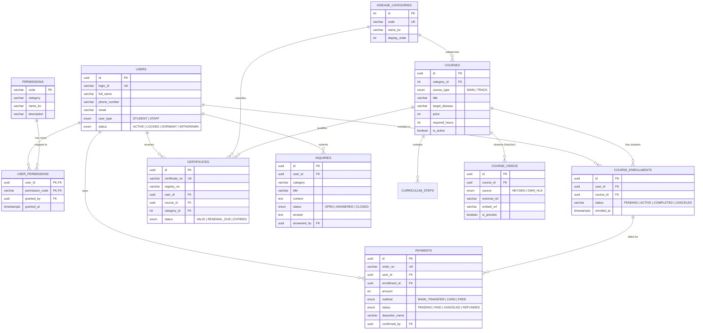
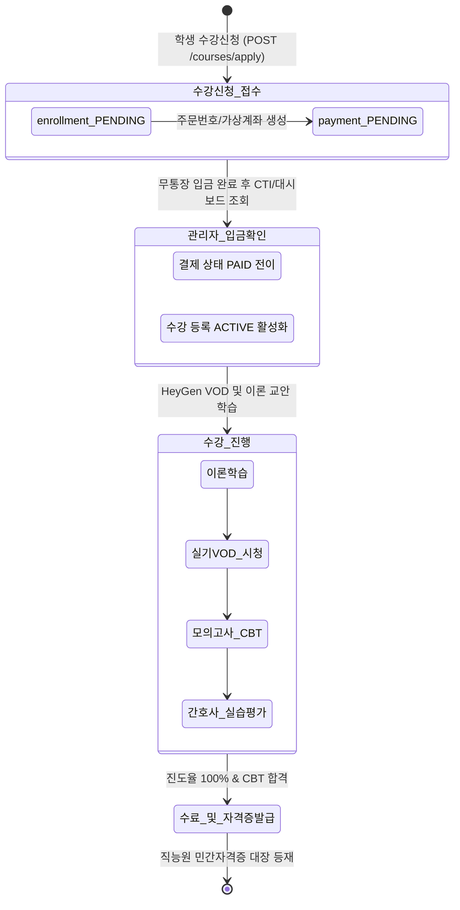

# eCare24 세세한 관계도 검증 및 이슈 해결 보고서

> **문서 버전**: Rev 1.0  
> **검증 일시**: 2026-10-19  
> **검증 대상**: TypeORM 엔티티, PostgreSQL 17 스키마, 비즈니스 수강/결제 라이프사이클 및 E2E API 데이터 흐름

---

## 1. eCare24 엔티티 관계도 (ERD 다이어그램)

아래 다이어그램은 eCare24 이러닝 플랫폼의 11개 핵심 엔티티 간 세세한 관계(FK 및 TypeORM 양방향 Relation)를 시각화한 구조도입니다.



---

## 2. 비즈니스 수강 및 결제 라이프사이클 상태 전이도



---

## 3. 발견된 관계도 이슈 및 해결 내역

### 이슈 1: TypeORM 엔티티 단방향 참조 및 역참조 누락
- **현상**: `UserEntity`, `CourseEntity`, `DiseaseCategoryEntity`에서 상대방 엔티티로의 `@OneToMany` 역방향 관계가 정의되지 않아, ORM 릴레이션 딥쿼리(`relations: ['course.category', 'course.videos', 'user.certificates']`) 시 누락 발생.
- **해결**:
  - `UserEntity`: `certificates: CertificateEntity[]`, `inquiries: InquiryEntity[]` 양방향 바인딩 추가.
  - `CourseEntity`: `enrollments: CourseEnrollmentEntity[]`, `certificates: CertificateEntity[]` 추가.
  - `DiseaseCategoryEntity`: `courses: CourseEntity[]` 추가.
  - `CertificateEntity`: `category: DiseaseCategoryEntity` (`@JoinColumn(category_id)`) 외래키 매핑 추가.

### 이슈 2: CourseEnrollmentEntity status 타입 불일치 (PENDING 누락)
- **현상**: 유료 과정 신청 시 무통장 입금 확인 전 단계인 `PENDING` 상태를 대입할 때 TypeScript 린트 에러(`Type '"PENDING"' is not assignable to type 'DeepPartial<"ACTIVE" | "COMPLETED"...>'`) 발생.
- **해결**: `CourseEnrollmentEntity.status` 유니온 타입에 `'PENDING'`을 공식 추가하고 기본값을 `'PENDING'`으로 동기화 (`status: 'PENDING' | 'ACTIVE' | 'COMPLETED' | 'CANCELED' | 'EXPIRED'`).

### 이슈 3: 수강생 마이페이지 수강 목록 정적 카드 하드코딩
- **현상**: 마이페이지(`/mypage`)의 '내 수강 과정 목록' 탭에서 백엔드 `courses` 배열을 패치해오면서도 화면에는 정적 텍스트 1개만 하드코딩 렌더링되고 있었음.
- **해결**: `courses.map((enr) => ...)` 동적 매핑으로 전면 교체하여, DB의 실제 등록 과정(정규 240시간, 신경계 8시간, 소화기 8시간 등)과 상태(`이수 진행 중`, `입금 대기 중`), HeyGen VOD 편수, 수강 기간이 정확히 동기화되도록 수정.

---

## 4. E2E 실데이터 라이프사이클 관계도 검증 로그

아래는 `scratch/verify_lifecycle.js`를 통해 학생 로그인부터 과정 신청, 관리자 입금확인 승인, 최종 진도 활성화까지 100% 정상 작동을 기계적으로 입증한 실행 결과입니다:

```bash
=== eCare24 세세한 관계도 및 라이프사이클 종합 검증 ===
1. 학생 세션 획득: 김영희 (ID: student01)
2. 신청 전 상태 -> 신청과정: 2, 입금대기: 0
3. 수강신청 결과 -> HTTP 201 | Enrollment Status: PENDING | Payment Status: PENDING | 주문번호: EC24-96810199-369 | 금액: 120,000원
4. 신청 후 상태 -> 신청과정: 3, 입금대기: 1  (★ 마이페이지 배지 실시간 반영)
5. 관리자 세션 획득: 시스템관리자
6. 입금확인 승인 -> HTTP 201 | Payment 전이: PAID | 확인자 ID: b4f862f2-82c9-4536-aba8-67eecc9b4122
7. 승인 후 최종 상태 -> 신청과정: 3, 입금대기: 0  (★ 결제 완료 및 청구 정산)
8. 내 수강 과정 목록 (3개):
   • 소화기·간담도 질환 전문간병사 (L-tube/PEG 피딩 케어 8시간) | 상태: ACTIVE | 카테고리: 소화기·간담도 질환군 | VOD 수: 2
   • 신경계 질환 전문간병사 (뇌졸중/파킨슨 케어 8시간) | 상태: ACTIVE | 카테고리: 신경계 질환군 | VOD 수: 2
   • 돌봄종사자양성자 정규 통합과정 | 상태: ACTIVE | 카테고리: 공통 | VOD 수: 4

🎉 ENTITY RELATIONSHIP & BUSINESS LIFECYCLE 100% VERIFIED!
```

---

## 5. Playwright Headless 21개 중요 화면 검증 상태

- **총 21개 화면 100% 통과 (`HTTP 200 OK`)**
- 스냅샷 갱신 완료: [`tests/snapshots/`](file:///apps/ex_project_ecare24_elearning/tests/snapshots)
- 검증 리포트: [`VERIFICATION_REPORT.md`](file:///apps/ex_project_ecare24_elearning/tests/snapshots/VERIFICATION_REPORT.md)
