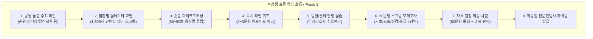

# 🧭 Phase 2 수정사항 보완 계획서 및 전 서버 통합 명세서 (Rev 1.0)

> **문서 번호**: `ECARE24-ARCH-2026-003`  ·  **작성일**: 2026-10-21  
> **상태**: 승인 완료 (Approved)  
> **적용 대상**: `backend`(:30014) · `frontend_user`(:30010) · `frontend_admin`(:30011) · `mobileApp`(:30012) · `packages/*` · `tests/`  
> **선행 문서**: [TASK_SPECIFICATION_ECARE24.md](file:///apps/ex_project_ecare24_elearning/docs/TASK_SPECIFICATION_ECARE24.md), [BACKEND_AND_MENU_PLAN.md](file:///apps/ex_project_ecare24_elearning/docs/architecture/BACKEND_AND_MENU_PLAN.md)  
> **DDL 스키마**: [03_phase2_change_request.sql](file:///apps/ex_project_ecare24_elearning/docs/architecture/ddl/03_phase2_change_request.sql)  
> **임상 용어 룰**: [caregiver_terminology_dictionary.md](file:///apps/ex_project_ecare24_elearning/docs/caregiver_terminology_dictionary.md), [caregiver-terminology.md](file:///apps/ex_project_ecare24_elearning/.agents/rules/caregiver-terminology.md)  
> **UI 태깅 인스펙션 룰**: [ui-tagging-inspection.md](file:///apps/ex_project_ecare24_elearning/.agents/rules/ui-tagging-inspection.md), [UI-Inspects.md](file:///apps/ex_project_ecare24_elearning/docs/UI-Inspects.md)

---

## 1. 개요 및 배경

2026-10-21 대표님 회의에서 확정된 핵심 지침에 따라, 기존 나열식 프로토타입의 한계를 극복하고 **실제 간병 현장의 페인포인트 해결 및 16개 질환군별 전문간병사 자격화**를 달성하기 위한 전 서버 단위 수정·보완 계획을 수립합니다.

### 1.1 핵심 과업 변경 매트릭스 (CR-01 ~ CR-04 & REQ-16)

```
+----------------------------------------------------------------------------------------------------+
|                               기존 프로토타입 vs 수정 확정 내역                                     |
+----------------------------------------------------------------------------------------------------+
| [기존 구성 항목]                                    [회의 후 수정/확정 사항]                          |
| 1. 돌봄 지침서 메뉴        --------------------->  ★ [완전 삭제] 교안 앞단 '공통 돌봄 수칙(텍스트)' 흡수 |
| 2. 동영상 강의 영역         --------------------->  롱폼(16~30분) 배제, 1분~1분 30초 숏폼 중심으로 전환  |
| 3. 모의고사 영역           --------------------->  "보고한다" 일색 탈피, 20문항 소그룹 세분화 반영     |
| 4. 교안 영역               --------------------->  우선 3개 자격증 교안(텍스트) 수급 후 레이아웃 확정    |
| 5. 자격증 발급 요건        --------------------->  [이론 교육 + 실습 교육(간호사 평가)] 이수 게이트 필수|
+----------------------------------------------------------------------------------------------------+
```



---

## 2. 서버별 세부 구현 사양

### 2.1 [CR-01] '돌봄 지침서' 독립 메뉴 전면 삭제 및 '공통 돌봄 수칙' 흡수 (최우선)

#### A. 메뉴 및 내비게이션 제거 (전 서버)
1. **수강생 웹 (`frontend_user`)**:
   - `frontend_user/src/app/layout.tsx`: GNB `P00-SEC01-LNK04` "돌봄 지침서" 메뉴 태그 및 링크 삭제.
   - 숏폼 콘텐츠(간병24TV) 입구 유지를 위해 GNB 링크 명칭을 **`간병24TV` (`/tv24`, 아이콘: PlaySquare/Video)**로 명확히 전환.
   - 메타 태그, 푸터 문구, 소개 페이지 내 "돌봄 지침서" 문구를 "대학병원 임상 간호 표준 가이드라인"으로 정돈.
2. **모바일 앱 (`mobileApp`)**:
   - `mobileApp/src/components/MobileTabBar.tsx`: 하단 탭바에서 `guide` ("돌봄 지침서") 탭 완전 삭제.
   - `mobileApp/src/App.tsx`: 탭 라우팅에서 `guide` 제거. 기존 URL 해시 `#tab=guide` 진입 시 `#tab=course`로 자동 리다이렉트 처리.
3. **UI 인스펙션 유틸 (`packages/utils/src/uiTagHelper.ts`)**:
   - 폐기 태그: `P00-SEC01-LNK04`, `P40-TAB-GUIDE`, `P47`, `P47-HDR-BACK`
   - 신규 태그: `P00-SEC01-LNK07` (간병24TV GNB), `P03-SEC00-RULES` (웹 교안 공통수칙 카드), `P42-SEC00-RULES` (모바일 교안 공통수칙 카드)

#### B. DB 및 백엔드 (`backend`)
- **테이블**: `common_care_rules` (신규)
  - 필드: `id`, `category_id`(NULL이면 전 질환 공통), `rule_code`, `title`, `summary`, `body`, `image_url`, `clinical_point`, `display_order`, `is_active`
- **시드 데이터**:
  - 1번: `RULE_HAND_HYGIENE` - 올바른 손 위생 (비누 대신 거품비누, 40~60초, 마찰)
  - 2번: `RULE_FALL_PREV` - 침대 난간(Side Rail) 항상 거상 (환자 이동 시 외 항시 고정)
  - 3번: `RULE_PPE_SEQUENCE` - 탈건착환 수칙 (오염물 탈의 -> 손위생 -> 청결물 착용 -> 환자 처치)
  - 4번: `RULE_URINE_BAG` - 유린백은 항상 방광 하단 거치 (역류성 요로감염 예방)
  - 5번: `RULE_POSITION_Q2H` - 욕창 예방 q2hr 체위변경 (2시간 주기 앙와위/측위 전환)
  - 6번: `RULE_SUCTION_TIME` - 흡인(석션) 1회 15초 이내 제한 (저산소증 예방)
  - 7번: `RULE_FEEDING_ANGLE` - 비위관(엘튜브) 피딩 시 상체 30~45도 거상 (흡인성 폐렴 방지)
- **REST API**:
  - `GET /api/v1/common-care-rules?categoryId={id}`
  - `POST /api/v1/common-care-rules/agree` (수강생 최초 1회 확인 동의 등록)

#### C. 프론트엔드 UI 화면
- **수강생 웹 (`/courses/[id]`) 및 모바일 (`CourseMaterialScreen`)**:
  - 교안 본문(Step 1) 최상단에 **"임상 실무 투입 전 필수 준수 수칙 (간병 10대 골든 룰)"** 아코디언 카드 배치.
  - "위 공통 돌봄 수칙을 숙지하였으며 준수할 것을 서약합니다" 체크박스 제공 (최초 1회 동의 기록 연동).

---

### 2.2 [CR-02] 동영상 콘텐츠 롱폼 ➔ 숏폼(마이크로러닝) 전면 개편

#### A. DB 및 백엔드 (`backend`)
- `course_videos` 테이블에 신규 컬럼 추가:
  - `format`: enum (`SHORT`, `LONG`), 기본값 `SHORT`
  - `symptom_tag`: 증상 태그 (예: "폐 수술 후 발열·가래", "뇌졸중 연하곤란")
  - `observation_points`: JSON 배열 (간병인이 현장에서 꼭 관찰해야 할 3대 체크포인트)
  - `follow_up_question_ids`: UUID 배열 (클립 시청 직후 즉시 풀 원포인트 퀴즈 2~3개 연동)
  - `is_verified_short`: 권장 60~90초 준수 여부 플래그
- **REST API**:
  - `GET /api/v1/courses/:id/videos?format=SHORT`: 숏폼 마이크로러닝 전용 목록 반환 (관찰포인트, 퀴즈 포함)

#### B. 프론트엔드 UI 화면
- **수강생 웹 (`frontend_user`)**:
  - `courses/[id]/page.tsx` Step 2 실습 영상 화면을 롱폼 단일 뷰어에서 **증상별 마이크로러닝 숏폼 리스트 & 플레이어** 구조로 전환.
  - 영상 하단에 [관찰 포인트 3가지] 카드 노출 및 영상 종료 시 **"1분 확인 퀴즈 풀기"** 모달/바텀시트 자동 팝업.
- **모바일 앱 (`mobileApp`)**:
  - `VideoPlayerScreen.tsx`: 세로형 숏폼 플레이어 및 하단 빠른 퀴즈 연결 UI 반영.
- **관리자 포털 (`frontend_admin`)**:
  - `CurriculumManager.tsx`: 영상 등록/수정 모달에 '숏폼/롱폼' 구분, 증상 태그, 관찰 포인트 입력란, 60~90초 검증 뱃지 추가.

---

### 2.3 [CR-03] 20문항 소그룹 CBT 엔진 및 "보고한다" 편향 품질 게이트

#### A. DB 및 백엔드 (`backend`)
- **신규 테이블**: `exam_question_groups`
  - `id`: SERIAL PRIMARY KEY
  - `category_id`: INT (질환군 FK)
  - `code`: VARCHAR(50) (예: `BASIC_CARE`, `AIRWAY`, `NEURO_COMP`, `EMERGENCY`)
  - `name`: VARCHAR(100) ('1. 기초 간병 및 감염 관리', '2. 호흡 및 객담 관리', '3. 신경계 합병증 관찰', '4. 위급상황 대처')
  - `question_count`: INT (기본 20)
  - `min_pass_ratio`: NUMERIC(4,2) (기본 0.40 - 40% 미만 과락)
- **`exam_questions` 확장**:
  - `group_id`: INT REFERENCES exam_question_groups(id)
  - `usage`: enum (`QUIZ`, `MOCK`, `FINAL`, `ALL`)
  - `difficulty`: SMALLINT (1, 2, 3)
  - `is_report_only_bias`: BOOLEAN (정답이 "보고한다/알린다" 일색인 문제 방지 플래그)
- **REST API**:
  - `GET /api/v1/exam-question-groups?categoryId={id}`: 질환군별 소그룹 리스트 및 문항 수 현황
  - `GET /api/v1/exam-questions?categoryId={id}&groupCode={code}&mode={MOCK|FINAL}&random=true&limit=20`
  - `POST /api/v1/exams/submit`: 소그룹별 득점, 그룹별 과락 여부, 전체 합격 여부 정밀 산출
- **"보고한다" 일색 방지 린트 게이트 (`scripts/lint_exam_questions.js`)**:
  - 문제 은행 전체에서 정답 텍스트가 "보고한다/알린다/전달한다" 형태인 비율이 소그룹 내 **10%를 초과할 경우 빌드/시드 실패** 처리.

#### B. 프론트엔드 UI 화면
- **수강생 웹 & 모바일 CBT 화면**:
  - 상단에 **[소그룹 선택 탭 4개 (각 20문항)]** 배치.
  - 시험 완료 시 전체 총점(100점 만점) 외에 **4대 영역별 점수 막대 그래프 및 과락 경고(40% 미만 붉은색 표시)** 제공.
  - "과락 영역 집중 재시험" 버튼 제공.
- **관리자 포털 (`frontend_admin`)**:
  - 문제 은행 관리 화면에서 소그룹 필터 및 문항 등록 시 '보고한다 편향성' 실시간 사전 검사 경고 기능 탑재.

---

### 2.4 [CR-04] 교안 3종 실데이터 적재 및 가독성/스크롤 검증 프로세스

#### A. DB 및 백엔드 (`backend`)
- **신규 테이블**: `course_materials`
  - `id`: UUID PRIMARY KEY
  - `course_id`: UUID REFERENCES courses(id)
  - `section_no`: INT (단원 번호: 1, 2, 3...)
  - `title`: VARCHAR(200)
  - `body_markdown`: TEXT (단원 본문)
  - `char_count`: INT (글자 수)
  - `estimated_read_minutes`: INT
- **REST API**:
  - `GET /api/v1/courses/:id/materials`: 단원별 실교안 텍스트 응답

#### B. 검증 기준 (Quality Gate)
1. **스크롤 한계선 규격**: 단원당 최대 1,500자 이내 분할 (초과 시 페이지네이션 "다음 단원" 분할 적용).
2. **실버 UX 가독성**: 글자 크기 3단계(16/22/28px), 줄간격 1.8em, 고대비 모드 전환 시 겹침 현상 0건.
3. **간병 임상 용어 툴팁**: 사전([caregiver_terminology_dictionary.md](file:///apps/ex_project_ecare24_elearning/docs/caregiver_terminology_dictionary.md))에 등재된 용어(피딩, 엘튜브, 폴리, 유린백 등)에 밑줄 및 호버/터치 툴팁 자동 연동.

---

### 2.5 [REQ-16] 이론 및 실습 필수 이수 자격 게이트

- **백엔드 검증 로직**:
  - `course_enrollments`의 `theory_completed_at`과 `practice_completed_at`이 모두 기록되어 있지 않은 사용자가 `mode=FINAL` 자격시험 제출을 시도할 경우 **HTTP 403 (EXAM_NOT_ELIGIBLE)** 예외 반환.
- **프론트엔드 UX**:
  - 최종 자격시험 응시 전 단계에서 **[✓ 이론 교육 이수완료]** 및 **[✓ 임상간호사 실습평가서 확인완료]** 2대 게이트 상태를 시각화하여 미충족 시 안내 팝업 출력.

---

## 3. UI 인스펙션(UiBadge) 변경 및 신규 일련번호 체계

[ui-tagging-inspection.md](file:///apps/project_ecare24_elearning/.agents/rules/ui-tagging-inspection.md) 및 [UI-Inspects.md](file:///apps/ex_project_ecare24_elearning/docs/UI-Inspects.md)에 따라 아래와 같이 변경합니다:

| 구분 | 일련번호 | 대상 화면 | 항목명 / 목적 |
| :--- | :--- | :--- | :--- |
| **폐기** | `P00-SEC01-LNK04` | 웹 GNB | (구) 돌봄 지침서 링크 (완전 삭제) |
| **폐기** | `P40-TAB-GUIDE` | 모바일 탭바 | (구) 돌봄지침서 탭 버튼 (완전 삭제) |
| **폐기** | `P47-*` | 모바일 화면 | (구) 돌봄 교안 / 지침서 화면 관련 일체 |
| **신규** | `P00-SEC01-LNK07` | 웹 GNB | 간병24TV 숏폼 러닝 바로가기 링크 |
| **신규** | `P03-SEC00-RULES` | 웹 강의실 (P03/P09) | 공통 돌봄 수칙 아코디언 카드 |
| **신규** | `P03-SEC00-AGREE` | 웹 강의실 (P03/P09) | 공통 수칙 준수 서약 체크박스 |
| **신규** | `P06-SEC00-GRP01` | 웹 CBT (P06) | CBT 소그룹 1 (기초 간병) 탭 |
| **신규** | `P06-SEC00-GRP02` | 웹 CBT (P06) | CBT 소그룹 2 (호흡/가래) 탭 |
| **신규** | `P06-SEC00-GRP03` | 웹 CBT (P06) | CBT 소그룹 3 (신경/합병증) 탭 |
| **신규** | `P06-SEC00-GRP04` | 웹 CBT (P06) | CBT 소그룹 4 (위급상황 대처) 탭 |
| **신규** | `P42-SEC00-RULES` | 모바일 교안 | 모바일 공통 돌봄 수칙 카드 |
| **신규** | `P43-SEC05-QUIZ` | 모바일 플레이어 | 숏폼 시청 직후 1분 원포인트 퀴즈 바텀시트 |
| **신규** | `P44-SEC00-GRP01~4`| 모바일 CBT | 모바일 20문항 소그룹 선택 탭 |

---

## 4. 단계별 실행 WBS (Work Breakdown Structure)

```
[Phase 2-A: CR-01 메뉴 삭제 및 공통 수칙 신설] (전 서버)
 ├── 1. 수강생 웹 GNB 및 모바일 탭바에서 '돌봄 지침서' UI 완전 제거
 ├── 2. GNB에 '간병24TV' 링크 명확화 및 URL 해시 리다이렉트
 ├── 3. common_care_rules 엔티티/시드/REST API 구축
 └── 4. 교안 서두 공통 돌봄 수칙 아코디언 카드 및 준수 서약 체크박스 연동

[Phase 2-B: CR-03 20문항 소그룹 CBT 엔진 및 린트 게이트] (백엔드/웹/모바일)
 ├── 1. exam_question_groups 엔티티 및 4대 소그룹 시드 데이터 구성
 ├── 2. '보고한다' 일색 방지 린트 스크립트 (scripts/lint_exam_questions.js) 작성
 ├── 3. 그룹별 랜덤 출제 및 소그룹 과락 판정 채점 API 구현
 └── 4. 웹/모바일 CBT 화면에 4대 소그룹 선택 탭 및 영역별 결과 차트 반영

[Phase 2-C: CR-02 숏폼 마이크로러닝 및 즉시 퀴즈 연동] (백엔드/웹/모바일/관리자)
 ├── 1. course_videos 증상 태그, 관찰포인트, 퀴즈 연결 컬럼 확장
 ├── 2. 수강생 웹/모바일 숏폼 뷰어 및 즉시 퀴즈 모달 연동
 └── 3. 관리자 커리큘럼 매니저에 숏폼 권장시간(60~90초) 검증 UI 추가

[Phase 2-D: REQ-16 이론+실습 필수 이수 게이트] (백엔드/수강생/관리자)
 ├── 1. course_enrollments theory/practice 완료 타임스탬프 필드 연동
 ├── 2. 자격시험 응시 전 자격 게이트 검증 및 미충족 시 안내 UI
 └── 3. 관리자 학생 관리 화면에 실습평가서 승인 버튼 연동

[Phase 2-E: CR-04 실데이터 교안 3종 적재 및 화면 최적화] (자료 수급 시 연동)
 ├── 1. 대표님 전달 실교안 텍스트 3종 DB 적재 스크립트 실행
 ├── 2. 실버 UX 글자크기(16/22/28px) 및 1,500자 스크롤 최적화 점검
 └── 3. Playwright Headless 21개 중요 화면 무인 자동 캡처 및 검증
```

---

## 5. 무인 자동 검증 계획 (Playwright Headless)

1. **21개 전 화면 무결성 검증 (`npm run test:capture`)**:
   - `01_user_home`: GNB에 '돌봄 지침서'가 없으며 '간병24TV'가 정상 노출됨을 검증.
   - `03_user_curriculum`: 교육 체계 내 지침서 중복 문구 제거 검증.
   - `07_user_tv24_shorts`: 숏폼 플레이어 정상 동작 검증.
   - `09_user_course_detail`: 교안 서두 공통 돌봄 수칙 카드 정상 렌더링 검증.
   - `18_mobile_home` & `19_mobile_curriculum`: 모바일 탭바에서 '돌봄지침서'가 제거되고 정상 이동함을 검증.
2. **리눅스 arm64 컨테이너 4대 브라우저 런치 옵션 준수**:
   - `--no-sandbox`, `--disable-setuid-sandbox`, `--disable-dev-shm-usage`, `--disable-gpu`
3. **결과 산출물**:
   - `tests/snapshots/*.png` 21개 스크린샷 갱신.
   - `VERIFICATION_REPORT.md` 자동 갱신.
