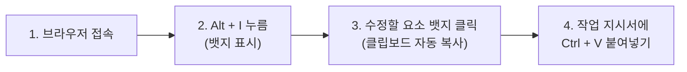
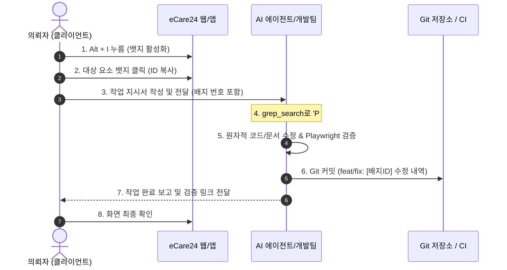

# eCare24 의뢰자 수정 사항 작업 지시서 가이드
## (Client Change Request & Work Order Guide with Badge IDs)

본 가이드는 eCare24 이러닝 플랫폼(수강생 포털, 관리자·콜센터 포털, 모바일 앱) 검토 중 발견된 **수정·개선 사항을 의뢰자(기획자, 현업 담당자, 클라이언트)가 개발팀 및 AI 에이전트에게 100% 오차 없이 정확하게 지시**할 수 있도록 돕는 실무 안내서입니다.

화면의 **인스펙션 뱃지 번호(Serial Badge ID)**를 활용하면, "세 번째 파란 버튼", "중간쯤에 있는 텍스트"와 같은 모호한 설명 없이 **단 1초 만에 대상을 특정**하여 신속하고 정확한 수정 작업을 이끌어낼 수 있습니다.

---

## 1. 뱃지 인스펙션 3단계 초간단 사용법

브라우저 화면에서 아래 3단계를 수행하면 수정 대상 요소의 고유 일련번호가 클립보드에 자동 복사됩니다.



### STEP 1. 인스펙션 뱃지 켜기 (단축키)
- 키보드에서 **`Alt + I`** (또는 `Ctrl + Shift + T`)를 누릅니다.
- 화면 내 모든 버튼, 텍스트, 입력창 좌상단에 **네온 바이올렛 뱃지**가 표시됩니다.
- *(작업 완료 후 다시 `Alt + I`를 누르면 원래 화면으로 깔끔하게 돌아갑니다.)*

### STEP 2. 뱃지 클릭 (원클릭 상세 정보 복사)
- 수정을 원하는 UI 요소 좌상단에 떠 있는 **뱃지를 마우스로 클릭**합니다.
- 뱃지 문구가 1.2초간 **`[Copied! ✓]`**로 바뀌며, 해당 요소의 **4대 핵심 정보(일련번호, 페이지명, URI, 항목명)**가 클립보드에 자동 복사됩니다.
- 화면 하단에 `📋 [P01-SEC01-BTN02] 정보 복사 완료! (일련번호/페이지/URI/항목명)` 토스트 알림이 뜹니다.

### STEP 3. 지시서에 붙여넣기 (Ctrl + V)
- 작업 지시서 문서나 메신저/이슈 트래커 입력창에 **`Ctrl + V`**로 붙여넣으면 아래와 같이 대상 요소 정보가 완벽히 입력됩니다:
  ```text
  - 일련번호: P01-SEC01-BTN02
  - 페이지명: 한국돌봄종사자양성교육원 메인 홈
  - URI: http://localhost:30010/curriculum
  - 항목명: 16대 질환 무료 수강
  ```
- 이후 원하시는 변경 요청 사항만 덧붙여 전송하시면 됩니다.

---

## 2. 배지 번호 체계 이해 (Cheat Sheet)

배지 번호는 **`[페이지(Page)]-[섹션(Section)]-[컴포넌트(Tag)]`** 3단계 구조로 구성되어 있어, 번호만 보고도 어느 화면의 어떤 영역인지 즉시 파악할 수 있습니다.

```text
  P01  -  SEC03  -  BTN02
  ──┬─    ───┬──    ───┬─
    │        │         └─ 컴포넌트: 2번째 버튼
    │        └─────────── 섹션: 3번째 섹션 (질환 카드 그리드)
    └──────────────────── 페이지: P01 (수강생 메인 홈)
```

### 2-1. 페이지 대역 (Page Range)
| 대역 | 대상 시스템 | 대표 화면 예시 |
| :--- | :--- | :--- |
| **`P00`** | **공통 레이아웃** | GNB 헤더, 글자크기 조절기 `[가-/가/가+]`, 고대비 토글, 이어보기 플로팅바 |
| **`P01 ~ P19`** | **수강생 포털 (`frontend_user`)** | P01 홈, P02 16대 질환 상세, P03 교안 뷰어, P04 실기 VOD, P06 CBT 시험 |
| **`P20 ~ P39`** | **관리자·콜센터 (`frontend_admin`)** | P20 대시보드, P21 콜센터 3분할 원스크린, P23 문제은행, P24 자격증 대장 |
| **`P40 ~ P59`** | **모바일 앱 (`mobileApp`)** | P41 모바일 홈, P43 숏폼 스와이프 플레이어, P46 모바일 CBT |

### 2-2. 컴포넌트 약어 (Tag Types)
- **`BTN`** : 버튼 (Button)
- **`TXT` / `LBL`** : 텍스트 / 라벨 / 타이틀 (Text / Label)
- **`INP`** : 입력창 (Text Input)
- **`SEL`** : 드롭다운 / 셀렉트박스 (Select / Dropdown)
- **`CRD`** : 카드 컨테이너 (Card)
- **`MOD`** : 모달 / 팝업 (Modal / Dialog)
- **`TAB`** : 탭 메뉴 (Tab)
- **`OMR`** : CBT 답안 마킹 시트 (OMR Sheet)

---

## 3. 의뢰자 수정 작업 지시서 표준 템플릿

작업 지시를 작성하실 때 아래 3가지 양식 중 상황에 맞는 템플릿을 복사하여 사용하세요.

### 템플릿 A. 기본 표 양식 (권장: 다건 수정 시 스프레드시트/이슈 등록용)

```markdown
### [작업 지시] eCare24 화면 UI/UX 수정 요청서
- **작성일자**: 2026-10-12
- **작성자**: [의뢰자 성함/직책]
- **대상 환경**: [수강생 포털 / 관리자-콜센터 / 모바일 앱]

| 연번 | 배지 번호 (Serial ID) | 대상 요소명 | 현재 상태 (As-Is) | 변경 요청 내용 (To-Be) | 우선순위 |
| :---: | :--- | :--- | :--- | :--- | :---: |
| 1 | P01-SEC01-BTN02 | 수강신청 바로가기 버튼 | 문구: '수강하기' / 남색 | 문구: '16대 질환 무료 수강' / 에메랄드(#059669) | 높음 |
| 2 | P03-SEC02-TXT01 | 교안 피딩 설명 본문 | "엘튜브 삽입 후 주입" | "비위관(L-tube) 피딩 전 상체 30~45° 거치 확인" | 긴급 |
| 3 | P21-SEC01-INP02 | 고객 주민번호 뒷자리 | 전체 노출됨 | 뒤 6자리 마스킹 처리(******) | 긴급 |
```

---

### 템플릿 B. 간이 채팅 양식 (단건 또는 슬랙/카카오톡/채팅창 보고용)

```markdown
[수정 요청]
(Ctrl + V 로 복사된 4대 정보 붙여넣기):
- 일련번호: P01-SEC01-BTN02
- 페이지명: 한국돌봄종사자양성교육원 메인 홈
- URI: http://localhost:30010/curriculum
- 항목명: 16대 질환 무료 수강

[변경 요청 사항]
1) 문구 변경: '16대 질환 무료 수강' -> '국비지원 무료 수강신청'
2) 색상 변경: 배경색을 에메랄드(#059669)로 변경
```

---

### 템플릿 C. 복합 기능/로직 수정 양식 (신규 로직 및 인터랙션 변경)

```markdown
### [기능 변경 지시서]
- **관련 화면 및 배지**: [P06-SEC02-CRD01] (디지털 OMR 마킹 패널)
- **현상 (As-Is)**: 문제 미선택 상태에서도 '답안 제출' 버튼이 즉시 활성화됨
- **요구사항 (To-Be)**:
  1. 전체 20문항 중 미응답 문항이 1개라도 있을 경우 경고 모달 표시 (`P06-MOD01`)
  2. 미응답 문항 번호를 빨간색 원형 뱃지로 강조 표시
  3. 60점 미만 또는 과락(40점 미만 과목) 발생 시 결과 화면(`P07-SEC01`)에 재응시 버튼 강조
- **임상/도메인 준수사항**: 직능원 자격관리규정 제14조 과락 기준(과목별 40점 미만 과락) 준수
```

---

## 4. 실전 작성 예시 (도메인 시나리오별)

### 예시 1. [수강생 포털] 실버 UX 및 가독성 개선
> **배지 번호**: `P00-SEC01-BTN03` (GNB 폰트 크기 조절기)  
> **요청 내용**:  
> - 폰트 확대 버튼 `[가+]` 클릭 시 최대 130%까지 확대되도록 단계 세분화 (현재 120% 상한).  
> - 글자 확대 시 버튼 호버 배경색을 고대비 옐로우(`#FACC15`)로 변경하여 저시력 고령자 시인성 강화.

### 예시 2. [교안 뷰어] 간병 임상 용어 및 골든 룰 교정
> **배지 번호**: `P03-SEC02-CRD04` (뇌졸중 체위변경 안전수칙 카드)  
> **요청 내용**:  
> - 기존 문구: "환자 자세를 자주 바꿔주세요."  
> - 변경 문구: **"욕창 예방을 위해 반드시 2시간마다 체위변경(q2hr 체변, 앙와위↔측위 30°)을 시행하며, 옷을 갈아입힐 때는 '탈건착환'(건강한 쪽 먼저 벗기고, 마비된 쪽 먼저 입힘) 원칙을 엄수하세요."**  
> - 용어사전 툴팁: `q2hr`, `탈건착환`, `앙와위`, `측위`에 점선 밑줄 및 마우스 호버 시 뜻풀이 툴팁 활성화.

### 예시 3. [CBT 시험장] 종이 감성 OMR 카드 및 타이머
> **배지 번호**: `P06-SEC02-OMR01` (우측 OMR 답안 시트)  
> **요청 내용**:  
> - 문제 번호 클릭 시 해당 문항으로 부드러운 스크롤 이동(`smooth scroll`).  
> - 마킹된 번호는 컴퓨터용 사인펜 느낌의 검정 타원형(`#1F2937`)으로 채워지고, 클릭 시 햅틱/진동 피드백 제공.

### 예시 4. [콜센터 포털] 상담사 CTI 3분할 화면 및 단축키 안내
> **배지 번호**: `P21-SEC01-BTN01` (좌측 1열 CTI 전화걸기 버튼)  
> **요청 내용**:  
> - 버튼 라벨에 단축키 안내 뱃지 추가: `[전화 걸기 (Alt+1)]`.  
> - 상담 저장 버튼(`P21-SEC03-BTN04`)에는 `[저장 (Alt+S)]` 단축키 힌트 툴팁 추가.  
> - 통화 종료 시 환자 상태 템플릿(피딩, 유린백, 욕창 등) 자동완성 칩 6종 즉시 노출.

---

## 5. Good vs Bad 작업 지시 비교

| 구분 | ❌ 나쁜 지시서 (Bad) | ✅ 좋은 지시서 (Good) | 차이점 및 개선 효과 |
| :--- | :--- | :--- | :--- |
| **대상 특정** | "메인 홈 화면 오른쪽 아래에 있는 파란 버튼 바꿔주세요." | **`[P01-SEC03-BTN02]`** 버튼 문구와 색상을 변경해주세요. | 에이전트/개발자가 화면 내 10여 개 버튼 중 헷갈리지 않고 0.1초 만에 특정. |
| **수정 내용** | "글씨를 좀 더 잘 보이게 키워주고 디자인 예쁘게 해주세요." | **`[P02-SEC01-TXT01]`** 타이틀 폰트 크기를 `24px`에서 `28px`로 키우고 굵기 `Bold`, 색상 `#111827`로 적용해주세요. | 주관적 표현 대신 정량적 수치와 명확한 사양 제시로 재수정 방지. |
| **임상 용어** | "소변줄 관리법 문구 고쳐주세요." | **`[P03-SEC02-CRD02]`** 카드의 '소변줄'을 **'유린백(도뇨관)'**으로 정정하고, **'유린백은 항상 방광보다 아래(골반 하단)에 위치하여 역류성 요로감염(UTI)을 예방해야 함'** 골든 룰을 명시해주세요. | 임상 표준 용어사전과 현장 골든 룰을 완벽히 일치시켜 법적/의학적 신뢰도 확보. |

---

## 6. 작업 지시 처리 워크플로우

의뢰자가 지시서를 전달하면, 개발팀 및 AI 에이전트는 아래와 같은 자동화 파이프라인으로 작업을 완수합니다.



---

## 7. 자주 묻는 질문 (FAQ)

**Q1. `Alt + I`를 눌렀는데 뱃지가 안 떠요.**  
- 브라우저 창 내부를 마우스로 한 번 클릭한 뒤 `Alt + I`를 눌러주세요.  
- 맥(Mac) 사용자의 경우 **`Option + I`** 또는 **`Cmd + Shift + T`**를 누르시면 됩니다.

**Q2. 모바일 기기나 태블릿에서는 어떻게 확인하나요?**  
- 모바일 화면 우측 하단에 숨겨진 플로팅 버튼(`🔍 인스펙터 토글`)을 탭하거나, 화면을 세 손가락으로 2초간 길게 터치하면 뱃지가 활성화됩니다.

**Q3. 새로 추가하고 싶은 영역이라 아직 뱃지 번호가 없어요.**  
- 인접한 가장 가까운 요소의 뱃지 번호를 기준으로 지시해주시면 됩니다.  
  - *예시: "`[P01-SEC02-CRD03]` 카드 바로 아래에 '전문 간병인 후기' 섹션 신규 추가"*

---

> [!TIP]
> **문의 및 피드백 지원**  
> 작업 지시서 작성 중 문의 사항이나 배지 체계 관련 제안은 eCare24 하네스 엔지니어링 전담팀에 언제든 전달해 주시기 바랍니다.
