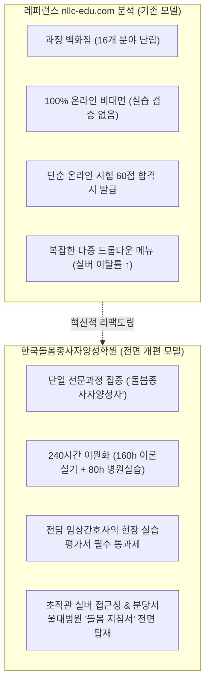
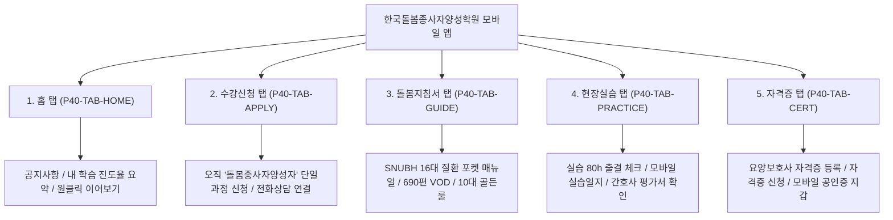
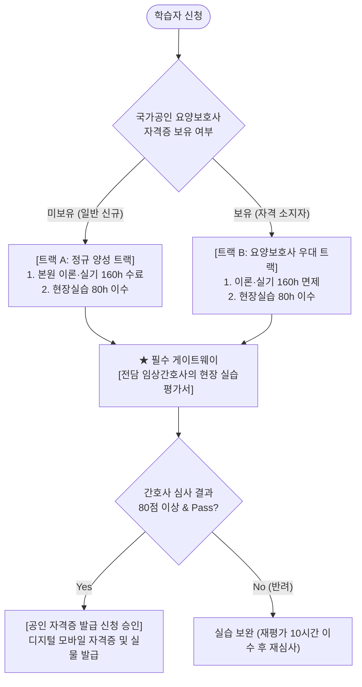

# 📋 [한국돌봄종사자양성학원] 웹·앱 디자인 및 메뉴 구성 전면 개편 종합 기획서
## (Revised IA, Menu Tree & Silver UX Specification for Web & App)

> **문서 버전**: Rev 2.0 (전면 개정판)  
> **기획 대상**: 한국돌봄종사자양성학원 수강생 웹 포털(`frontend_user`), 모바일 앱(`mobileApp`), 심사자/간호사 관리 포털(`frontend_admin`)  
> **기준 레퍼런스**: [국민평생교육원 (https://nllc-edu.com/)](https://nllc-edu.com/) 분석 및 차별화  
> **연계 임상 교안**: [분당서울대학교병원 16대 질환군 전수 마스터 커리큘럼 (snubh_16_disease_care_curriculum.md)](file:///apps/project_ecare24_elearning/docs/snubh_16_disease_care_curriculum.md)  
> **표준 룰 준수**: [GEMINI.md](file:///apps/project_ecare24_elearning/GEMINI.md), [AGENTS.md](file:///apps/project_ecare24_elearning/AGENTS.md), [caregiver-terminology.md](file:///apps/project_ecare24_elearning/.agents/rules/caregiver-terminology.md), [ui-tagging-inspection.md](file:///apps/project_ecare24_elearning/.agents/rules/ui-tagging-inspection.md)

---

## 1. 개요 및 의뢰자 요구사항 대조 분석표

### 1-1. 배경 및 전면 개편 목적
본 기획은 기존 다수의 민간자격 백화점식 플랫폼 또는 복잡한 대학교 이러닝 형태를 탈피하여, **「한국돌봄종사자양성학원」**의 고유 브랜드 정체성과 **중장년·실버 학습자(50~60대 요양보호사 및 간병 준비생)**의 인지적 특성에 완벽하게 최적화된 초직관적 웹·앱 인터페이스를 수립하는 것을 목적으로 합니다.

### 1-2. 의뢰자 핵심 요구사항 5대 과제 대조 분석

| 번호 | 의뢰자 요구사항 | 현행 문제점 (As-Is / 레퍼런스 nllc-edu) | 개편 방향 (To-Be: 한국돌봄종사자양성학원) | 반영 화면 및 모듈 |
| :---: | :--- | :--- | :--- | :--- |
| **REQ-01** | **수강생 눈높이 결정 및 접근성 극대화**<br>(생략 가능한 잡다한 메뉴 전면 제거) | • nllc-edu: 16개 복잡한 자격 카테고리(반려동물, 뷰티, IT, 공예 등) 난립<br>• 다중 서브메뉴로 실버 학습자 이탈 초래 | • 불필요한 카테고리/배너/광고성 팝업 100% 제거<br>• 폰트 3단계 조절(`[가-/가/가+]`), 고대비 모드, 큰 버튼(최소 48px), 간결한 1-Depth 네비게이션 | • 웹: GNB 4대 핵심 메뉴<br>• 앱: 5대 직관 하단 탭바<br>• WCAG AAA 실버 바 |
| **REQ-02** | **수강 신청 메뉴의 단일화**<br>(「돌봄종사자양성자 과정」 단 1개 과정) | • 다양한 과정 선택창에서 수강생 혼란 발생 | • 수강 신청 메뉴 클릭 시 오직 **「돌봄종사자양성자 과정」** 단일 과정으로 직행<br>• 불필요한 검색/필터 단계 생략, 원클릭 신청 퍼널 | • 웹: `[P01-SEC02-CRD01]`<br>• 앱: `[P40-TAB-APPLY]` |
| **REQ-03** | **이수 과정 교육체계의 이원화**<br>(160시간 이론·실기 + 80시간 현장실습 = 총 240시간) | • 단순 동영상 시청 수료증 발급에 그침<br>• 현장 실습과의 연계 및 시간 분리 부재 | • **[1영역: 이론+실기 160시간]** 이러닝 및 실기 VOD<br>• **[2영역: 현장실습 80시간]** 협약 요양병원 현장실습<br>• 두 영역의 진도율 및 이수 상태를 명확히 분리 대시보드화 | • 웹: `[P02-SEC01-DASH]`<br>• 앱: `[P42-SEC01-STAT]`<br>• DDL: 이원화 이수 테이블 |
| **REQ-04** | **자격증 신청 조건 엄격화**<br>(이론 수료 or 요양보호사 + 간호사 실습평가서 Pass) | • 시험 점수만으로 자격증 즉시 발급<br>• 임상 적격성 및 현장 검증 부재 | • **트랙 A**: 본원 이론(160h) 수료 + 실습(80h)<br>• **트랙 B**: 요양보호사 자격증 소지자 + 실습(80h)<br>• **필수 게이트**: 심사자인 **임상간호사의 현장 실습평가서 합격(Pass)** 확인 시에만 신청 버튼 활성화 | • 웹: `[P05-SEC01-CERT]`<br>• 앱: `[P44-SEC01-VERIF]`<br>• 관리자: 간호사 평가 모듈 |
| **REQ-05** | **메뉴 구성에 '돌봄 지침서' 독립 구성**<br>(분당서울대병원 16대 질환 커리큘럼 연동) | • 일반 자료실이나 FAQ 게시판 구석에 방치되어 현장 활용성 전무 | • 최상위 메인 메뉴로 **「돌봄 지침서」** 전면 배치<br>• **분당서울대학교병원 16대 질환군·71개 단위·690편 전수** 질환별/증상별 스마트 임상 핸드북 탑재 | • 웹: `[P04-SEC01-GUIDE]`<br>• 앱: `[P43-SEC01-HANDBOOK]` |

---

## 2. 레퍼런스(nllc-edu.com) 심층 분석 및 벤치마킹 & 차별화 전략



### 2-1. nllc-edu의 채택 요소 (Benchmarked Strengths)
1. **단순 명료한 헤더 상단 브랜딩**: 기관 로고와 전화번호(고객센터)의 명확한 강조.
2. **시인성 높은 자격증 발급 안내 절차**: 접수 → 수강 → 실습 → 평가 → 발급의 5단계 시각적 인포그래픽.
3. **원클릭 빠른 수강/자격증 신청 버튼**: 스크롤 어디서든 접근 가능한 직관적 플로팅 버튼.

### 2-2. nllc-edu 대비 한국돌봄종사자양성학원의 전면 개선 요소 (Differentiations)
1. **잡다한 16개 카테고리 전면 숙청**: 심리, 안전, 뷰티, IT, 공예 등 본원과 무관한 모든 메뉴를 100% 제거하고 오직 **돌봄 전문 교육**으로 압축.
2. **실버 특화 UI (WCAG AAA)**: 글자 크기 3단계 즉시 조절(`[가-]` 16px, `[가]` 18px, `[가+]` 20px), 고대비 흑백/황색 모드 지원.
3. **의료 임상 신뢰도 확보 (분당서울대병원 연계)**: 분당서울대학교병원 16대 질환 690편 기반 **돌봄 지침서**를 수강생 평생 임상 매뉴얼로 상시 제공.
4. **간호사 실습평가 게이트웨이**: 허수 수료증을 원천 차단하고 실제 환자 케어(10대 골든 룰: 탈건착환, q2hr 체변, 유린백 방광 하단 거치, 석션 15초 이내 등) 평가를 통과한 자에게만 공인 자격증 발급.

---

## 3. 웹 포털 (`frontend_user`) 전면 개편 정보구조도 (IA) & 메뉴 트리

### 3-1. 웹 GNB 메뉴 구조도 (As-Is 대비 불필요 메뉴 전면 제거)

```text
[한국돌봄종사자양성학원 웹 GNB 구조]
│
├── [P00-SEC00] 실버 접근성 유틸리티 탑바
│    ├── 글자크기 3단계 조절기 [가- (16px) | 가 (18px) | 가+ (20px)]
│    ├── 고대비 모드 토글 [켜기 / 끄기]
│    └── 심사자·간호사 포털 바로가기 링크 (:30011)
│
├── [P00-SEC01] 메인 글로벌 내비게이션 (GNB)
│    ├── [로고] 한국돌봄종사자양성학원 (Korea Care Worker Academy)
│    ├── [M01] 학원소개 (원장 인사말, 간호사 교수진, 지정 실습의료기관, 오시는 길)
│    ├── [M02] 수강신청 (★오직 단일과정: 「돌봄종사자양성자 과정」 240시간 상세 및 신청)
│    ├── [M03] 교육체계 안내 (160시간 이론·실기 + 80시간 현장실습 이원화 로드맵)
│    ├── [M04] 돌봄 지침서 (★분당서울대병원 16대 질환군 690편 임상 가이드북)
│    ├── [M05] 자격증 신청 (요양보호사 보유자 / 이론 수료자 + 간호사 평가서 확인 발급)
│    └── [M06] 나의 강의실 (내 진도율, 실습일지, 평가서 확인, 자격증 보관함)
│
└── [P00-SEC02] 실버 안심 플로팅 독 (하단 고정)
     ├── ☎ 전화상담 연결 (1588-2424)
     ├── [Alt+I] UI 인스펙터 뱃지 복사 토글 독
     └── 최근 학습 강의 이어보기 퀵바
```

### 3-2. 웹 화면별 상세 구성 및 와이어프레임 명세

#### ① 메인 홈 (`/`, `[P01]`)
- **[P01-SEC01-BNR01] 메인 비주얼 배너**: 
  - 카피: *"돌봄의 시작부터 병원 현장까지 — 한국돌봄종사자양성학원"*
  - 서브: *160시간 이론·실기 + 80시간 병원실습으로 완성하는 공인 전문 돌봄인력*
  - 액션 버튼: `[P01-SEC01-BTN01] 돌봄종사자양성자 과정 수강신청 바로가기`, `[P01-SEC01-BTN02] 16대 질환 돌봄 지침서 열람하기`
- **[P01-SEC02-CRD01] 단일 수강과정 핵심 요약 카드**:
  - 교육시간: 총 240시간 (이론·실기 160시간 + 현장실습 80시간)
  - 신청 자격: 돌봄 분야 취업 희망자 누구나 (요양보호사 자격증 소지자 이론 감면 우대)
  - 수강 혜택: 분당서울대학교병원 690편 돌봄 지침서 평생 무료 열람권 제공
- **[P01-SEC03-STP01] 5단계 취득 로드맵 인포그래픽**:
  - `1. 수강신청` → `2. 160h 이론·실기 이수` → `3. 80h 병원실습` → `4. 간호사 실습평가 합격` → `5. 공인 자격증 발급`
- **[P01-SEC04-GD01] 실시간 인기 돌봄 지침서 퀵뷰**:
  - 16대 질환 중 최빈도 질환 4종 숏컷 (뇌졸중 편마비 케어, COPD 산소요법, 욕창 체변 q2hr, 비위관 피딩 가이드)

#### ② 수강신청 단일 페이지 (`/courses/apply`, `[P02]`)
- **[P02-SEC01-DTL01] 과정 상세 개요**: 오직 「돌봄종사자양성자 과정」 1개 과정만 노출.
- **[P02-SEC02-TRK01] 학습자 유형 선택 탭**:
  - `[유형 1: 일반 수강생]` 160시간 이론·실기 수강 신청 (기본 트랙)
  - `[유형 2: 요양보호사 자격증 소지자]` 자격번호 입력 및 이론 감면 신청 (실습 80시간 집중 트랙)
- **[P02-SEC03-FRM01] 간편 입학원서 양식**: 성명, 연락처, 생년월일, 희망 실습지역(서울/경기/인천 등 지정 협약병원) 선택.
- **[P02-SEC04-BTN01] 원클릭 수강신청 완료 버튼**: 대형 안심 버튼 (높이 56px, 시인성 높은 에메랄드 컬러).

#### ③ 교육체계 이원화 안내 페이지 (`/curriculum`, `[P03]`)
- **[P03-SEC01-TAB01] 이원화 교육체계 2분할 탭**:
  - **영역 1 (이론 및 실기 160시간)**: 이러닝 이론 100시간 (기초간호, 노인복지, 질환별 케어) + 실기 시뮬레이션 VOD 60시간 (체위변경, 식사보조, 배뇨배설)
  - **영역 2 (현장실습 80시간)**: 협약 의료기관(요양병원, 종합병원 간병병동) 10일간(1일 8시간) 현장배치 실습 규정
- **[P03-SEC02-TBL01] 시간표 및 이수 기준 명세표**:
  - 출석률 80% 이상 + 모의평가(CBT) 60점 이상 + 현장 간호사 평가서 80점 이상 필수

#### ④ 돌봄 지침서 메인 포털 (`/guidebook`, `[P04]`)
- **[P04-SEC01-SCH01] 질환 및 케어 증상 즉시 검색창**: "엘튜브", "체위변경", "유린백", "욕창", "파킨슨" 등 키워드 검색.
- **[P04-SEC02-NAV01] 분당서울대학교병원 16대 질환군 아코디언 메뉴**:
  - 01군 신경계(59편), 02군 호흡기계(25편), 03군 심혈관계(47편), 04군 근골격계(50편), 05군 소화기간담도(54편), 06군 비뇨기신장(73편), 07군 내분비대사(34편), 08군 종양암(34편), 09군 인지정신치매(26편), 10군 감염성(13편), 11군 중환자(13편), 12군 외상화상(20편), 13군 노인성복합(184편), 14군 호스피스(10편), 15군 소아희귀(24편), 16군 응급기도연하(24편)
- **[P04-SEC03-CRD01] 10대 골든 룰 퀵 가이드 카드**: 탈건착환, q2hr 체변, 유린백 방광 하단 거치, 석션 15초 이내 등 시각화 인포그래픽.

#### ⑤ 자격증 신청 및 심사 검증 페이지 (`/certification/apply`, `[P05]`)
- **[P05-SEC01-CHK01] 자격증 신청 적격성 자동 검증기**:
  - `조건 1 검증`: [본원 160h 이론수료 Pass] OR [요양보호사 자격증 승인 Pass]
  - `조건 2 검증`: [80h 현장실습 수료] AND **[담당 간호사 실습평가서 최종 합격 (Pass)]**
  - 두 조건이 모두 충족되었을 때만 `[P05-SEC01-BTN01] 공인 자격증 발급 신청하기` 활성화!
- **[P05-SEC02-VW01] 심사 간호사 평가서 열람 모달**: 수강생이 본인의 실습 채점 결과(총점 및 항목별 피드백) 투명하게 확인.

---

## 4. 모바일 앱 (`mobileApp`) 전면 개편 정보구조도 (IA) & 5대 탭바 구성

모바일 앱은 작은 스마트폰 화면을 사용하는 5060 수강생의 사용성을 고려하여, **하단 고정 5대 탭바(Bottom Tab Bar)**로 완전히 재구성합니다.



### 4-1. 모바일 앱 5대 하단 탭바 명세표 (`MobileTabBar`)

| 탭 순서 | 탭 명칭 | 아이콘 | Serial Badge ID | 주 화면 내용 및 핵심 기능 |
| :---: | :--- | :--- | :--- | :--- |
| **TAB 1** | **홈** | `Home` | `[P40-TAB-HOME]` | • 학원 소개 및 공지사항<br>• 나의 이론(160h) / 실습(80h) 진도율 바<br>• 원클릭 '마지막 보던 강의 이어보기' |
| **TAB 2** | **수강신청** | `BookOpenCheck` | `[P40-TAB-APPLY]` | • **단일과정 「돌봄종사자양성자 과정」** 간편 신청<br>• 터치 친화형 입학원서 작성<br>• 1588-2424 직통 전화상담 바로걸기 |
| **TAB 3** | **돌봄지침서** | `BookMarked` | `[P40-TAB-GUIDE]` | • **분당서울대학교병원 16대 질환군 모바일 핸드북**<br>• 오프라인 다운로드 캐싱 지원 (병원 음영지역 대비)<br>• 긴급 임상 케어 1분 쇼츠 및 10대 골든 룰 |
| **TAB 4** | **현장실습** | `Stethoscope` | `[P40-TAB-PRACTICE]` | • 80시간 현장실습 기관 안내 및 배정 조회<br>• 모바일 당일 실습일지 작성 및 서명<br>• **지도 간호사 실습평가서 합격 여부 실시간 확인** |
| **TAB 5** | **자격증** | `Award` | `[P40-TAB-CERT]` | • 요양보호사 자격증 카메라 촬영 제출<br>• 조건 충족 시 공인 자격증 발급 신청<br>• 위변조 방지 QR코드 내장 모바일 자격증 지갑 |

### 4-2. 모바일 앱 실버 친화적 특화 디자인 규칙
1. **터치 타겟 영역**: 모든 클릭 가능한 버튼 및 탭의 높이는 최소 **54px 이상** 확보.
2. **글자 크기 조절**: 상단 헤더에 `[가/가+]` 2단계 돋보기 토글 상시 고정.
3. **가로 스와이프 제스처**: 16대 질환군 카드를 한 손가락으로 쉽게 넘겨볼 수 있는 직관적 카드 슬라이더.
4. **오프라인 캐싱 (PWA/RN)**: 요양병원 지하 병동이나 통신 불안정 환경에서도 핵심 돌봄 지침서 텍스트와 10대 골든 룰 즉시 열람 가능.

---

## 5. 이원화 교육체계 (160시간 + 80시간) 상세 규격

한국돌봄종사자양성학원은 보건복지부 요양보호사 표준 교재 및 임상 의료 현장의 기준에 맞추어 총 **240시간**의 교육을 엄격히 이원화하여 운영합니다.

```mermaid
gantt
    title 한국돌봄종사자양성학원 총 240시간 이원화 교육 프로세스
    dateFormat  X
    axisFormat  %s일
    section 1영역: 이론·실기 (160h)
    기초이론 및 노인의료 복지 (온라인) : 0, 10
    16대 질환별 임상 간병 (이러닝)     : 10, 20
    실기 시뮬레이션 VOD & CBT 평가      : 15, 25
    section 2영역: 현장실습 (80h)
    협약 요양병원 배치 (1일 8h x 10일) : 25, 35
    지도간호사 현장 실기 코칭 & 관찰    : 25, 35
    간호사 실습평가서 최종 심사 (Pass)  : 34, 36
    section 최종 자격 검정
    자격증 발급 신청 및 발급 승인       : 36, 38
```



### 5-1. 제1영역: 이론 및 실기 (160시간)
- **목표**: 돌봄 이론, 직업 윤리, 노인성 질환, 16대 임상 질환에 대한 체계적 지식 습득.
- **구성**:
  - `기초간호 및 복지이론 (60시간)`: 인체 구조, 노화의 특성, 노인복지법률, 인권 보호.
  - `16대 질환별 전문간병 (60시간)`: 분당서울대병원 커리큘럼 연동 (신경계, 호흡기, 소화기 등).
  - `기본간호 실기 VOD (40시간)`: 앙와위/측위 체위변경, 비위관 피딩, 유치도뇨관 유린백 거치, 석션 보조 등.
- **수료 기준**: 출석(진도율) **80% 이상** + 모의 CBT 시험 **60점 이상**.

### 5-2. 제2영역: 현장실습 (80시간)
- **목표**: 실제 요양병원 및 재가 복지 현장에서 환자 대상 1:1 케어 실무 숙달.
- **구성**:
  - `지정 협약 의료기관 배치`: 1일 8시간씩 총 10일간 진행.
  - `전담 지도간호사 매칭`: 실습생 1인당 담당 수간호사 또는 전담 임상간호사가 배정되어 실습 지도.
- **수료 기준**: 80시간 전일 출석 + **지도간호사의 「현장 실습평가서」 80점 이상 획득 (Pass 판정)**.

---

## 6. 자격증 신청 조건 및 간호사 실습평가 심사 엔진

### 6-1. 자격증 발급 2대 트랙



### 6-2. 지도간호사의 현장 실습평가서 10대 임상 채점표 (간병 10대 골든 룰 반영)

심사자인 간호사는 `frontend_admin`의 간호사 전용 모바일/웹 평가창(`[P25-NURSE-EVAL]`)에서 실습생의 수행 능력을 10대 항목(각 10점, 총 100점 만점)으로 평가합니다. **80점 이상 획득 시 최종 합격(Pass)** 처리됩니다.

| 번호 | 평가 항목 (임상 케어 술기) | 배점 | 중점 검증 기준 (10대 골든 룰 기반) | 판정 기준 (양호/보통/미흡) |
| :---: | :--- | :---: | :--- | :---: |
| **01** | **체위변경 및 욕창 예방 (q2hr 체변)** | 10점 | 2시간 간격 앙와위-측위-반좌위 순환 준수, 베개 지지, 피부 발적 확인 | 10 / 7 / 4점 |
| **02** | **의복 갈아입히기 (탈건착환 원칙)** | 10점 | 편마비 환자 의복 탈의 시 건강한 쪽 먼저, 착의 시 마비된 쪽 먼저 준수 여부 | 10 / 7 / 4점 |
| **03** | **경관유동식(L-tube) 피딩 보조** | 10점 | 피딩 전 상체 30~45° 거치 확인, 주입 속도 조절, 주입 후 30분 좌위 유지 | 10 / 7 / 4점 |
| **04** | **유치도뇨관 및 유린백(소변백) 관리** | 10점 | 유린백을 항상 방광보다 낮은 위치에 거치, 줄 꼬임 방지, 바닥 접촉 차단 | 10 / 7 / 4점 |
| **05** | **구강 및 기도 분비물 흡인(석션) 보조** | 10점 | 멸균 카테터 준수, 1회 흡인 15초 이내 제한, 환자 청색증 관찰 | 10 / 7 / 4점 |
| **06** | **휠체어 이송 및 낙상 예방 수칙** | 10점 | 휠체어 건강한 쪽에 30~45° 밀착, 잠금장치 체결, 침상 난간 항상 거치 | 10 / 7 / 4점 |
| **07** | **개인위생 및 침상 목욕/세발 간병** | 10점 | 프라이버시 유지(가림막), 체온 유지, 미온수 온도 확인, 말초에서 중심으로 | 10 / 7 / 4점 |
| **08** | **감염 관리 및 개인보호구(PPE) 착용** | 10점 | 환자 접촉 전후 30초 손위생, 일회용 장갑/마스크 올바른 착탈의 | 10 / 7 / 4점 |
| **09** | **활력징후 측정 및 이상 징후 보고** | 10점 | 혈압/체온/맥박 이상치 즉각 의료진(간호사) 구두 인계 여부 | 10 / 7 / 4점 |
| **10** | **환자 권리 존중 및 치매 환자 공감 소통** | 10점 | 존칭 사용, 치매 환자 환각/섬망 시 비난하지 않고 현실 지남력 자극 | 10 / 7 / 4점 |
| **합계** | **총 10개 임상 실기 영역** | **100점** | **합격 기준: 80점 이상 (단, 01~05 골든룰 과락 4점 미만 없을 것)** | **Pass / Fail** |

---

## 7. '돌봄 지침서' (분당서울대병원 16대 질환군) 메뉴 구성 상세

`docs/snubh_16_disease_care_curriculum.md`에 수록된 690편의 전문 임상 VOD와 지침을 수강생 웹 및 모바일 앱의 핵심 메뉴인 **「돌봄 지침서」**로 체계화합니다.

```text
[돌봄 지침서 16대 질환군 디렉토리 구조]
├── 제01군. 신경계 질환군 (59편) ── 뇌졸중 편마비 간병, 파킨슨병 보행장애, 뇌전증 발작 대처
├── 제02군. 호흡기계 질환군 (25편) ─ COPD 산소요법, 기관절개관 캐뉴라 소독, 객담 배출
├── 제03군. 심혈관계 질환군 (47편) ─ 심부전 부종 관리, 협심증 니트로글리세린 복약 보조
├── 제04군. 근골격계 질환군 (50편) ─ 인공관절 치환술 후 탈구 예방, 고관절 골절 간병, 척추재활
├── 제05군. 소화기계 질환군 (54편) ─ L-tube 피딩, 위루관(PEG) 관리, 장루(인공항문) 백 교체
├── 제06군. 비뇨기계 질환군 (73편) ─ 만성신부전 투석 환자 수분제한, 유치도뇨관(폴리) 케어
├── 제07군. 내분비계 질환군 (34편) ─ 당뇨 인슐린 저혈당 쇼크 감시, 당뇨발 궤양 드레싱 보조
├── 제08군. 종양·암 질환군 (34편) ── 항암 오심·구토 식이요법, 호중구감소증 무균 격리 간병
├── 제09군. 인지·치매 질환군 (26편) ─ 알츠하이머 배회 방지, 섬망 대처, BPSD 비약물적 중재
├── 제10군. 감염성 질환군 (13편) ── CRE/VRE 접촉격리 가운 착용, 결핵 음압격리 N95 마스크
├── 제11군. 중환자 집중케어 (13편) ─ ICU 퇴원 와상환자 토탈케어, 인공호흡기 의존환자 케어
├── 제12군. 외상·화상 질환군 (20편) ─ 중증 낙상 환자 이송, 피부이식 부위 보습 및 압박 간병
├── 제13군. 노인성 복합만성 (184편) ─ 다약제 복용(Polypharmacy) 관리, 와상환자 욕창 드레싱
├── 제14군. 호스피스 완화 (10편) ── 임종기 호흡(체인스톡스) 돌봄, 통증 조절, 가족 정서지지
├── 제15군. 소아 희귀난치 (24편) ── 소아 뇌성마비 특수간병, 연하재활 보조
└── 제16군. 응급기도·연하 (24편) ── 연하곤란 점도증진제 식사보조, 기도폐쇄 하임리히법, 석션
```

---

## 8. UI 일련번호 전수 부여 명세 (Web & App) 및 Alt+I 연동 체계

본 플랫폼은 의뢰자가 화면 검토 중 **"어느 페이지의 어느 버튼인지"** 1초 만에 특정하여 지시할 수 있도록 모든 인터랙션 요소에 고유 일련번호 뱃지를 부착합니다.

### 8-1. 웹 포털 (`frontend_user`) 신규 일련번호 체계

| 일련번호 (Badge ID) | 대상 요소명 | 화면 위치 | 클릭 시 동작 / 인터랙션 |
| :--- | :--- | :--- | :--- |
| **`P00-SEC00-BTN01`** | 글자크기 3단계 조절기 | 상단 실버 탑바 | 16px / 18px / 20px 순환 변경 |
| **`P00-SEC00-BTN02`** | 고대비 모드 토글 버튼 | 상단 실버 탑바 | 고대비 흑백/노랑 테마 전환 |
| **`P00-SEC01-LOG01`** | 학원 공식 로고 링크 | GNB 헤더 좌측 | 메인 홈(`/`) 이동 |
| **`P00-SEC01-LNK01`** | 학원소개 메뉴 | GNB 네비게이션 | 학원소개 및 교수진 안내 페이지 이동 |
| **`P00-SEC01-LNK02`** | **수강신청 (단일과정)** | GNB 네비게이션 | 「돌봄종사자양성자 과정」 단일 신청서 이동 |
| **`P00-SEC01-LNK03`** | 교육체계 안내 | GNB 네비게이션 | 160h 이론+80h 실습 이원화 로드맵 이동 |
| **`P00-SEC01-LNK04`** | **돌봄 지침서** | GNB 네비게이션 | 분당서울대병원 16대 질환 포털 이동 |
| **`P00-SEC01-LNK05`** | **자격증 신청** | GNB 네비게이션 | 적격성 검증 및 자격증 발급 신청 이동 |
| **`P00-SEC01-LNK06`** | 나의 강의실 | GNB 네비게이션 | 내 학습 진도 및 실습평가서 확인 이동 |
| **`P01-SEC01-BTN01`** | 메인 수강신청 바로가기 | 메인 배너 중앙 | `/courses/apply` 이동 |
| **`P01-SEC01-BTN02`** | 메인 돌봄지침서 바로보기 | 메인 배너 중앙 | `/guidebook` 이동 |
| **`P02-SEC01-BTN01`** | 단일 수강과정 즉시 접수 | 수강신청 페이지 하단 | 입학원서 제출 및 등록 완료 |
| **`P05-SEC01-BTN01`** | **자격증 발급 신청 버튼** | 자격증 신청 페이지 | 이론+간호사평가 Pass 확인 시 발급 처리 |

### 8-2. 모바일 앱 (`mobileApp`) 신규 일련번호 체계

| 일련번호 (Badge ID) | 대상 요소명 | 화면 위치 | 클릭 시 동작 / 인터랙션 |
| :--- | :--- | :--- | :--- |
| **`P40-TAB-HOME`** | 홈 탭 버튼 | 하단 탭바 1번째 | 모바일 메인 홈 화면 전환 |
| **`P40-TAB-APPLY`** | **수강신청 탭 버튼** | 하단 탭바 2번째 | 단일과정 간편 입학원서 전환 |
| **`P40-TAB-GUIDE`** | **돌봄지침서 탭 버튼** | 하단 탭바 3번째 | 16대 질환 모바일 핸드북 전환 |
| **`P40-TAB-PRACTICE`** | **현장실습 탭 버튼** | 하단 탭바 4번째 | 80시간 실습일지 및 간호사 평가서 전환 |
| **`P40-TAB-CERT`** | **자격증 탭 버튼** | 하단 탭바 5번째 | 요양보호사 인증 및 모바일 자격증 지갑 |
| **`P41-SEC01-BTN01`** | 모바일 강의 이어보기 | 홈 대시보드 상단 | 최근 학습 중이던 동영상 플레이어 즉시 실행 |
| **`P43-SEC01-SCH01`** | 지침서 퀵 검색창 | 돌봄지침서 상단 | 질환/증상 키워드 실시간 필터링 |
| **`P44-SEC01-BTN01`** | 간호사 평가서 결과 열람 | 현장실습 화면 중앙 | 10대 항목 채점표 상세 모달 호출 |

---

## 9. 데이터베이스 DDL 스키마 확장안 (이원화 교육 & 간호사 평가)

의뢰자의 요구사항인 **160h 이론+80h 실습 이원화** 및 **간호사 실습평가서 필수 승인제**를 완벽하게 뒷받침하기 위해 신규 테이블 및 필드를 정의합니다.

```sql
-- =============================================================================
-- 1. 수강생 이원화 교육 이수 마스터 테이블 (Course Enrollment & Dual Track)
-- =============================================================================
CREATE TABLE care_enrollments (
    enrollment_id UUID PRIMARY KEY DEFAULT gen_random_uuid(),
    student_id UUID NOT NULL REFERENCES users(id),
    course_code VARCHAR(50) DEFAULT 'CARE-WORKER-240H', -- 단일과정: 돌봄종사자양성자 과정
    student_type VARCHAR(20) NOT NULL CHECK (student_type IN ('REGULAR', 'CAREGIVER_CERT_HOLDER')), -- 일반신규 or 요양보호사
    caregiver_cert_number VARCHAR(100), -- 요양보호사 자격증 번호 (트랙B)
    caregiver_cert_verified BOOLEAN DEFAULT FALSE,
    
    -- 1영역: 이론 및 실기 (160시간)
    theory_hours_completed NUMERIC(5, 1) DEFAULT 0.0, -- 완료 시간
    theory_progress_rate NUMERIC(5, 2) DEFAULT 0.0,   -- 진도율 (%)
    theory_cbt_score INTEGER,                         -- 모의 CBT 점수
    theory_passed BOOLEAN DEFAULT FALSE,              -- 160h 이론 이수 여부
    
    -- 2영역: 현장실습 (80시간)
    practice_hospital_name VARCHAR(150),              -- 배정 요양병원명
    practice_hours_completed NUMERIC(5, 1) DEFAULT 0.0, -- 실습 완료 시간 (최대 80h)
    practice_passed BOOLEAN DEFAULT FALSE,            -- 80h 실습 완료 여부
    
    -- 최종 자격증 신청 가능 여부
    is_eligible_for_cert BOOLEAN GENERATED ALWAYS AS (
        ((theory_passed = TRUE) OR (caregiver_cert_verified = TRUE)) 
        AND (practice_passed = TRUE)
    ) STORED,
    
    created_at TIMESTAMP WITH TIME ZONE DEFAULT CURRENT_TIMESTAMP,
    updated_at TIMESTAMP WITH TIME ZONE DEFAULT CURRENT_TIMESTAMP
);

-- =============================================================================
-- 2. 임상간호사 현장 실습평가서 테이블 (Nurse Clinical Field Evaluation)
-- =============================================================================
CREATE TABLE nurse_field_evaluations (
    evaluation_id UUID PRIMARY KEY DEFAULT gen_random_uuid(),
    enrollment_id UUID NOT NULL REFERENCES care_enrollments(enrollment_id),
    nurse_id UUID NOT NULL REFERENCES users(id), -- 평가 심사 간호사
    nurse_license_number VARCHAR(50) NOT NULL,   -- 간호사 면허번호
    practice_hospital_id VARCHAR(50) NOT NULL,
    
    -- 간병 10대 골든 룰 임상 평가 점수 (각 10점 만점)
    score_q2hr_repositioning INTEGER CHECK (score_q2hr_repositioning BETWEEN 0 AND 10), -- 1. 체위변경
    score_undress_healthy_first INTEGER CHECK (score_undress_healthy_first BETWEEN 0 AND 10), -- 2. 탈건착환
    score_ltube_feeding INTEGER CHECK (score_ltube_feeding BETWEEN 0 AND 10),           -- 3. 비위관 피딩
    score_foley_urine_bag INTEGER CHECK (score_foley_urine_bag BETWEEN 0 AND 10),       -- 4. 유린백 하단
    score_suction_safety INTEGER CHECK (score_suction_safety BETWEEN 0 AND 10),         -- 5. 석션 15초
    score_fall_prevention INTEGER CHECK (score_fall_prevention BETWEEN 0 AND 10),       -- 6. 낙상예방
    score_personal_hygiene INTEGER CHECK (score_personal_hygiene BETWEEN 0 AND 10),     -- 7. 개인위생
    score_infection_ppe INTEGER CHECK (score_infection_ppe BETWEEN 0 AND 10),           -- 8. 감염관리 PPE
    score_vital_signs_report INTEGER CHECK (score_vital_signs_report BETWEEN 0 AND 10), -- 9. 활력징후 보고
    score_patient_dignity INTEGER CHECK (score_patient_dignity BETWEEN 0 AND 10),       -- 10. 환자권리 존중
    
    total_score INTEGER GENERATED ALWAYS AS (
        score_q2hr_repositioning + score_undress_healthy_first + score_ltube_feeding +
        score_foley_urine_bag + score_suction_safety + score_fall_prevention +
        score_personal_hygiene + score_infection_ppe + score_vital_signs_report + score_patient_dignity
    ) STORED,
    
    evaluation_result VARCHAR(10) CHECK (evaluation_result IN ('PASS', 'FAIL')), -- 80점 이상 시 PASS
    nurse_opinion TEXT,                                                          -- 간호사 총평 및 지도소견
    evaluated_at TIMESTAMP WITH TIME ZONE DEFAULT CURRENT_TIMESTAMP
);
```

---

## 10. 향후 추진 일정 (WBS) 및 스프린트 계획

비개발 원칙에 따라 본 기획 승인 이후 각 개발 파트(웹 프론트, 모바일 앱, 백엔드)가 즉각 구현에 돌입할 수 있도록 4단계 스프린트를 구성합니다.

| 단계 | 기간 | 작업 단위 (Work Packages) | 산출물 및 마일스톤 |
| :---: | :---: | :--- | :--- |
| **Phase 1** | Sprint 1 | • 웹 포털(`frontend_user`) GNB 및 홈 화면 전면 리팩토링<br>• 잡다한 카테고리 제거 및 단일 수강신청 화면 제작 | • 신규 GNB 탑재 완료<br>• 단일 수강신청 퍼널 작동 |
| **Phase 2** | Sprint 2 | • 모바일 앱(`mobileApp`) 5대 하단 탭바(`MobileTabBar`) 개편<br>• 실버 터치 UI 및 가로 스와이프 적용 | • 모바일 5대 탭 UI 완비<br>• 글자크기/고대비 모드 연동 |
| **Phase 3** | Sprint 3 | • 돌봄 지침서 16대 질환군(690편) 스마트 뷰어 구축<br>• 키워드 즉시 검색 및 10대 골든 룰 퀵 카드 제작 | • 돌봄 지침서 라이브러리 오픈<br>• 모바일 오프라인 캐싱 지원 |
| **Phase 4** | Sprint 4 | • 간호사 실습평가서 모듈 및 자격증 발급 승인 로직 개발<br>• 전 화면 `Alt+I` UI 인스펙션 뱃지 검증 | • 간호사 평가서 Pass 게이트 완성<br>• 자격증 발급 프로세스 오픈 |

---

## 11. 의뢰자 피드백 수렴 체크리스트

의뢰자께서는 본 종합 기획서를 검토하신 후, 수정이나 추가가 필요한 부분이 있을 경우 화면의 **UI 뱃지 번호(`Alt + I`)**와 함께 아래 체크리스트를 활용해 피드백을 주시면 즉각 반영하겠습니다.

- [x] **기관명 확인**: 「한국돌봄종사자양성학원」 브랜드명 적용 여부
- [x] **접근성 확인**: 레퍼런스의 잡다한 16개 카테고리 전면 제거 및 실버 특화 UI 적용 여부
- [x] **수강신청 확인**: 오직 「돌봄종사자양성자 과정」 단일과정만 노출되는지 여부
- [x] **교육체계 확인**: 160시간(이론·실기) + 80시간(현장실습)의 240시간 이원화 명세 여부
- [x] **자격증 조건 확인**: (이론수료 or 요양보호사) + (간호사 실습평가 Pass) 2중 게이트웨이 설계 여부
- [x] **돌봄지침서 확인**: 분당서울대병원 16대 질환군 690편이 최상위 메인 메뉴로 독립 배치되었는지 여부
- [x] **웹/앱 일관성 확인**: 웹 GNB 및 모바일 5대 하단 탭바의 유기적 매핑 여부
